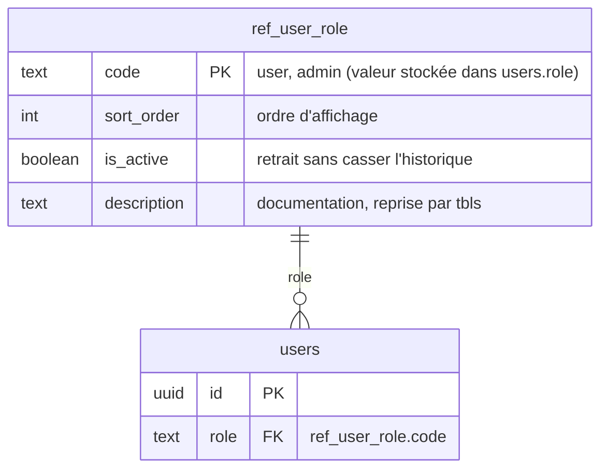

# Modèle de données (conception)

> Modèle de conception, recopié du cahier des charges (section 7.4, `docs/spec.md`) et tenu à jour à chaque décision de modélisation (ADR-16). Le schéma réel, généré par tbls à partir des changesets Liquibase dans `docs/database/schema/`, fait foi en cas d'écart.

## Modèle de données

- `users` : prénom, nom (obligatoires), nom d'utilisateur unique (URL du profil et des voyages), e-mail, e-mail vérifié (date), mot de passe (empreinte Argon2id), rôle (utilisateur, administrateur), statut, empreintes des jetons de vérification et de réinitialisation, nombre d'échecs de connexion, blocage jusqu'à, date du dernier changement de mot de passe, secret TOTP chiffré (administrateurs), date de confirmation de l'âge minimum, espace utilisé, préférences (langue, thème)
- `travels` : titre, description, slug (unique par propriétaire, utilisé dans l'URL), auteur, photo de couverture
- `medias` : membre ayant ajouté la photo, fournisseur de stockage (`cloudinary` ou `s3`), clé du fichier (l'URL de diffusion est calculée à la lecture, jamais stockée en dur), type (photo ou vidéo), durée pour les vidéos, empreinte du fichier (détection des doublons), fuseau horaire, taille, date de prise de vue, latitude / longitude, lieu (ville, région, pays), description
- `refresh_tokens` : utilisateur, empreinte du jeton, famille de rotation, expiration, date de révocation, appareil
- `auth_events` : journal des événements d'authentification (type, utilisateur, date, adresse IP, résultat)
- `travel_members` : voyage, utilisateur, rôle (propriétaire, contributeur, lecteur), date d'ajout
- `reports` : contenu signalé (voyage ou média), motif, auteur du signalement, statut (ouvert, traité, rejeté), décision
- `admin_audit_log` : administrateur, action, type et identifiant de la cible, motif, date, adresse IP (ajout seul, 12 mois)
- `privacy_requests` : utilisateur ou e-mail demandeur, type (accès, export, rectification, suppression), date de réception, échéance, statut, date de traitement
- `legal_acceptances` : utilisateur, document (CGU, politique de confidentialité), version acceptée, date
- `travel_invitations` : voyage, e-mail invité, rôle proposé, jeton unique, expiration, statut (en attente, acceptée, expirée, annulée), auteur de l'invitation

## Tables de référence

> 📚 Toute liste de valeurs récurrente (rôles, statuts, types, motifs…) est définie dans une **table de référence** préfixée `ref_`, liée par clé étrangère aux colonnes qui l'utilisent, et reflétée par un enum Java. Aucune valeur de liste n'est stockée en texte libre.

- **Structure commune** : `code` (clé primaire, valeur stockée telle quelle dans la table qui l'utilise), `sort_order`, `is_active`, `description`
- **Le code sert de clé primaire** : `users.role` contient `'admin'`, avec une clé étrangère vers `ref_user_role.code` ; les données restent lisibles sans jointure et la base refuse toute valeur inconnue
- **Enum Java en miroir** (`UserRole.USER`, `UserRole.ADMIN`), mappé en `@Enumerated(EnumType.STRING)` ; un test d'intégration vérifie que chaque enum et sa table contiennent exactement les mêmes valeurs
- **Libellés hors base** : traduits par le front dans `fr.json` / `en.json` (clé `ref.user_role.admin`), comme le reste de l'interface
- **Valeurs chargées par Liquibase**, un changeset par table ; ajouter ou retirer une valeur passe par un changeset et une PR ; une valeur retirée passe à `is_active = false` sans être supprimée si elle est encore utilisée
- Nommage : préfixe `ref_`, noms et codes en anglais, minuscules séparées par des tirets bas

| Table de référence | Valeurs initiales | Utilisée par |
| --- | --- | --- |
| `ref_user_role` | user, admin | `users.role` |
| `ref_user_status` | active, disabled | `users.status` |
| `ref_locale` | fr, en | `users.locale` |
| `ref_theme` | dark, light | `users.theme` |
| `ref_travel_role` | owner, contributor, reader | `travel_members.role`, `travel_invitations.role` (owner exclu par contrainte) |
| `ref_invitation_status` | pending, accepted, expired, cancelled | `travel_invitations.status` |
| `ref_media_type` | photo, video | `medias.type` |
| `ref_storage_provider` | cloudinary, s3 | `medias.storage_provider` |
| `ref_geocoding_source` | photon, geonames, manual | `medias.geocoding_source` |
| `ref_report_reason` | inappropriate, copyright, privacy, spam, other | `reports.reason` |
| `ref_report_status` | open, resolved, rejected | `reports.status` |
| `ref_privacy_request_type` | access, export, rectification, erasure | `privacy_requests.type` |
| `ref_privacy_request_status` | open, done, rejected | `privacy_requests.status` |
| `ref_legal_document` | terms, privacy | `legal_acceptances.document` |
| `ref_auth_event_type` | register, email\_verified, login, login\_failed, account\_locked, logout, token\_refreshed, token\_reuse\_detected, password\_reset\_requested, password\_reset, password\_changed, email\_changed | `auth_events.type` |
| `ref_admin_action` | view\_report, hide\_content, delete\_content, warn\_user, reject\_report, disable\_account, enable\_account, delete\_account, view\_auth\_events, revoke\_sessions, handle\_privacy\_request | `admin_audit_log.action` |

- Les futurs référentiels suivent la même règle, par exemple `ref_tag` pour les tags et activités (Should have), qui pourra porter des attributs supplémentaires (icône)
- Dans le diagramme ci-dessous, les tables de référence et leurs relations sont dessinées avec leur seule colonne `code` et ses valeurs initiales ; les colonnes communes (`sort_order`, `is_active`, `description`) sont omises pour la lisibilité

## Diagramme du modèle de données

> 🗂️ Diagramme de conception, écrit en Mermaid et tenu à jour à chaque décision (copie dans `docs/database/model.md`). Le schéma réel, généré automatiquement par tbls à partir des changesets Liquibase, fait foi en cas d'écart.

```mermaid
erDiagram
    users ||--o{ travel_members : "est membre de"
    travels ||--o{ travel_members : "a pour membres"
    users ||--o{ travels : "crée"
    travels ||--o{ medias : "contient"
    users ||--o{ medias : "ajoute"
    travels |o--o| medias : "photo de couverture"
    travels ||--o{ travel_invitations : "a pour invitations"
    users ||--o{ travel_invitations : "invite"
    users ||--o{ refresh_tokens : "possède"
    users |o--o{ auth_events : "génère"
    users ||--o{ reports : "signale"
    travels |o--o{ reports : "est signalé"
    medias |o--o{ reports : "est signalé"
    users ||--o{ legal_acceptances : "accepte"
    users ||--o{ admin_audit_log : "administre"
    users |o--o{ privacy_requests : "demande"

    ref_user_role ||--o{ users : "role"
    ref_user_status ||--o{ users : "status"
    ref_locale ||--o{ users : "locale"
    ref_theme ||--o{ users : "theme"
    ref_travel_role ||--o{ travel_members : "role"
    ref_travel_role ||--o{ travel_invitations : "role"
    ref_invitation_status ||--o{ travel_invitations : "status"
    ref_media_type ||--o{ medias : "type"
    ref_storage_provider ||--o{ medias : "storage_provider"
    ref_geocoding_source |o--o{ medias : "geocoding_source"
    ref_report_reason ||--o{ reports : "reason"
    ref_report_status ||--o{ reports : "status"
    ref_privacy_request_type ||--o{ privacy_requests : "type"
    ref_privacy_request_status ||--o{ privacy_requests : "status"
    ref_legal_document ||--o{ legal_acceptances : "document"
    ref_auth_event_type ||--o{ auth_events : "type"
    ref_admin_action ||--o{ admin_audit_log : "action"

    users {
        uuid id PK
        text email UK
        timestamptz email_verified_at
        text password_hash "Argon2id"
        text first_name "prénom"
        text last_name "nom"
        text username UK "unique, URL du profil et des voyages"
        text role FK "ref_user_role"
        text status FK "ref_user_status"
        int failed_login_count
        timestamptz locked_until
        timestamptz password_changed_at
        text totp_secret_enc "administrateurs"
        timestamptz age_confirmed_at "16 ans ou plus"
        bigint storage_used_bytes
        text locale FK "ref_locale"
        text theme FK "ref_theme"
        timestamptz created_at
    }

    travels {
        uuid id PK
        uuid created_by FK
        text title
        text description
        text slug "unique par utilisateur"
        uuid cover_media_id FK
        date start_date
        date end_date
        timestamptz created_at
    }

    travel_members {
        uuid travel_id PK, FK
        uuid user_id PK, FK
        text role FK "ref_travel_role"
        timestamptz joined_at
    }

    medias {
        uuid id PK
        uuid travel_id FK
        uuid uploaded_by FK
        text type FK "ref_media_type"
        text storage_provider FK "ref_storage_provider"
        text storage_key UK
        text file_hash "détection des doublons"
        bigint size_bytes
        int duration_seconds "vidéos"
        timestamptz taken_at "UTC"
        text timezone
        double latitude
        double longitude
        text place_city
        text place_region
        text place_country
        text geocoding_source FK "ref_geocoding_source"
        text camera_model
        text description
        timestamptz created_at
    }

    travel_invitations {
        uuid id PK
        uuid travel_id FK
        uuid invited_by FK
        text email
        text role FK "ref_travel_role (sauf owner)"
        text token_hash UK
        timestamptz expires_at "7 jours"
        text status FK "ref_invitation_status"
        timestamptz created_at
    }

    refresh_tokens {
        uuid id PK
        uuid user_id FK
        text token_hash UK "SHA-256"
        uuid family_id "rotation"
        text device
        timestamptz expires_at
        timestamptz revoked_at
    }

    auth_events {
        uuid id PK
        uuid user_id FK "vide si compte inconnu"
        text type FK "ref_auth_event_type"
        boolean success
        inet ip_address
        timestamptz created_at "conservé 12 mois"
    }

    reports {
        uuid id PK
        uuid reporter_id FK
        uuid travel_id FK
        uuid media_id FK
        text reason FK "ref_report_reason"
        text status FK "ref_report_status"
        text decision
        timestamptz created_at "conservé 12 mois"
    }

    legal_acceptances {
        uuid id PK
        uuid user_id FK
        text document FK "ref_legal_document"
        text version
        timestamptz accepted_at
    }

    admin_audit_log {
        uuid id PK
        uuid admin_id FK
        text action FK "ref_admin_action"
        text target_type "user, travel, media, report, privacy_request"
        uuid target_id
        text reason "obligatoire"
        inet ip_address
        timestamptz created_at "ajout seul, 12 mois"
    }

    privacy_requests {
        uuid id PK
        uuid user_id FK "vide si le demandeur n'a pas de compte"
        text requester_email
        text type FK "ref_privacy_request_type"
        timestamptz received_at
        timestamptz due_at "un mois"
        text status FK "ref_privacy_request_status"
        timestamptz completed_at
    }

    ref_user_role {
        text code PK "user, admin"
    }

    ref_user_status {
        text code PK "active, disabled"
    }

    ref_locale {
        text code PK "fr, en"
    }

    ref_theme {
        text code PK "dark, light"
    }

    ref_travel_role {
        text code PK "owner, contributor, reader"
    }

    ref_invitation_status {
        text code PK "pending, accepted, expired, cancelled"
    }

    ref_media_type {
        text code PK "photo, video"
    }

    ref_storage_provider {
        text code PK "cloudinary, s3"
    }

    ref_geocoding_source {
        text code PK "photon, geonames, manual"
    }

    ref_report_reason {
        text code PK "inappropriate, copyright, privacy, spam, other"
    }

    ref_report_status {
        text code PK "open, resolved, rejected"
    }

    ref_privacy_request_type {
        text code PK "access, export, rectification, erasure"
    }

    ref_privacy_request_status {
        text code PK "open, done, rejected"
    }

    ref_legal_document {
        text code PK "terms, privacy"
    }

    ref_auth_event_type {
        text code PK "register, login, login_failed, … (12 valeurs)"
    }

    ref_admin_action {
        text code PK "view_report, hide_content, … (11 valeurs)"
    }
```

## Documentation du schéma

- **Modèle de conception** : diagramme Mermaid ci-dessus, recopié dans `docs/database/model.md` ; mis à jour à la main (ou par l'agent) à chaque décision de modélisation ; affiché par GitHub, Notion et l'aperçu Markdown de l'IDE
- **Schéma réel généré** : `just db-docs` démarre un PostgreSQL temporaire (Docker), applique les changesets Liquibase et lance **tbls**, qui produit `docs/database/schema/` (une page Markdown par table, colonnes, index, contraintes, diagramme Mermaid)
- **Contrôle en CI** : `tbls diff` fait échouer la PR si la documentation générée ne correspond plus au schéma
- **Développement agentique** : skill `/new-changeset` (crée le changeset Liquibase, lance `just db-docs`, met à jour `model.md` si le modèle change) ; serveur MCP PostgreSQL en lecture seule sur la base locale pour que l'agent consulte le schéma réel
- Commentaires de tables et de colonnes définis dans les changesets Liquibase (`remarks`), repris automatiquement par tbls

