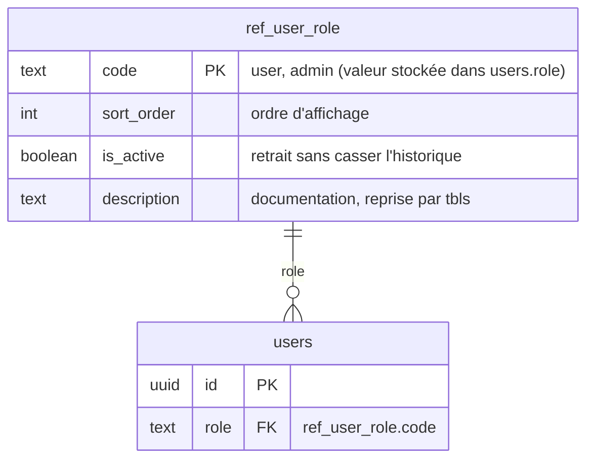

# Cahier des charges - Wherely

> 🗺️ **Wherely** — *Your journey, mapped.*<br>Cahier des charges produit

| **Projet** | Wherely — Application web progressive (PWA) de journal de voyage |
| --- | --- |
| **Version** | v1.3 |
| **Date** | Novembre 2026 |
| **Statut** | Document de référence |
| **Auteur** | Product Manager |
| **Confidentialité** | Usage interne — confidentiel |

> 💡 Wherely est une **application web progressive (PWA)** : accessible depuis n'importe quel navigateur, installable sur l'écran d'accueil mobile et desktop, sans passer par les stores. Toutes les données sont stockées côté serveur : l'utilisateur retrouve ses voyages sur tous ses appareils. Front en React + TypeScript + Vite, backend en Java / Spring Boot, hébergement sur un VPS OVHcloud, médias sur Cloudinary.

---

# 1. Présentation du projet

## 1.1 Contexte

Les voyageurs accumulent des centaines de photos sans jamais les organiser de manière cohérente. Les albums manuels sont fastidieux, les réseaux sociaux ne respectent ni la chronologie ni la géographie, et les outils existants ne tirent pas parti des données déjà présentes dans les fichiers photos.<br>Wherely est une application web progressive qui exploite automatiquement les métadonnées EXIF embarquées dans chaque photo (coordonnées GPS, date et heure, modèle d'appareil) pour créer des journaux de voyage visuels, structurés et partageables — sans aucune saisie manuelle de la part de l'utilisateur.

## 1.2 Problème résolu

- Les photos de voyage ne sont pas organisées automatiquement par destination ou par jour
- Il n'existe pas d'outil simple permettant de générer un récit visuel de voyage à partir de photos brutes
- Les outils de partage actuels (réseaux sociaux, galeries cloud) ignorent la dimension géographique et chronologique des souvenirs

## 1.3 Vision produit

> 🎯 Wherely doit devenir la référence du journal de voyage photo, accessible partout : un espace personnel et beau, utilisable sur mobile comme sur ordinateur, où chaque voyage se raconte de lui-même dès l'import des photos, avec la carte comme colonne vertébrale narrative.

## 1.4 Pourquoi une PWA

- **Un seul code** pour mobile, tablette et desktop, au lieu de deux apps natives + un site de partage
- **Pas de validation des stores** : déploiement continu, pas de délai de review ni de commission
- **Installable** sur l'écran d'accueil (Android, iOS 16.4+, Chrome/Edge desktop) avec une expérience plein écran
- **Partage entre proches** : un ami invité rejoint le voyage depuis un simple lien d'invitation, sans installer d'application
- **Import facilité sur desktop** : les photographes amateurs importent leurs fichiers directement depuis l'ordinateur
- **Coût réduit** : une équipe front unique au lieu de compétences iOS/Android

# 2. Objectifs & indicateurs de succès

## 2.1 Objectifs stratégiques

- Mettre en production la v1.0 de la PWA avant fin juin 2027
- Atteindre 10 000 utilisateurs actifs dans les 3 mois suivant le lancement
- Obtenir un taux d'installation de la PWA d'au moins 25 % chez les utilisateurs actifs
- Générer un taux de rétention à J30 supérieur à 40 %

## 2.2 KPIs principaux

| Indicateur | Cible | Mesure |
| --- | --- | --- |
| Rétention J7 | > 60 % | Sessions actives à J7 post-inscription |
| Rétention J30 | > 40 % | Sessions actives à J30 post-inscription |
| Voyages créés / utilisateur | > 2 sur 3 mois | Moyenne par utilisateur actif |
| Taux de partage | > 15 % | Voyages avec au moins un membre invité / voyages créés |
| Taux d'installation PWA | > 25 % | Utilisateurs ayant installé l'app / utilisateurs actifs |
| Satisfaction (NPS) | > 40 | Enquête in-app après le 2e voyage créé |
| Score Lighthouse | > 90 | Performance, Accessibilité, Bonnes pratiques |
| Temps d'import moyen | \< 30 secondes | Pour 100 photos avec EXIF GPS |

# 3. Périmètre du projet

## 3.1 Dans le périmètre (In Scope)

- Application web progressive responsive (mobile, tablette, desktop)
- Installation sur l'écran d'accueil via Web App Manifest et service worker
- Accès aux voyages depuis tous les appareils de l'utilisateur (mobile, tablette, ordinateur)
- Lecture et exploitation des métadonnées EXIF : GPS, horodatage, modèle d'appareil
- Détection automatique des voyages par clustering géographique et temporel
- Carte interactive par voyage avec tracé d'itinéraire et épingles photo
- Timeline chronologique jour par jour avec photos groupées par lieu
- Profil utilisateur avec carte mondiale des pays visités
- Invitation d'amis à un voyage (rôle lecteur ou contributeur), accès réservé aux utilisateurs inscrits
- Interface multilingue : français et anglais dès la V1, architecture prête pour d'autres langues
- Authentification utilisateur (email + OAuth Google/Apple)
- Stockage de tous les voyages côté serveur : métadonnées dans PostgreSQL, photos et vidéos sur Cloudinary ; aucune donnée de voyage conservée dans le navigateur

## 3.2 Hors périmètre (Out of Scope) — V1

- Applications natives iOS / Android publiées sur les stores (une publication Play Store via TWA pourra être étudiée en V2)
- Consultation des voyages sans connexion (mode hors ligne complet) : étude en V2
- Reconnaissance d'image par IA (identification automatique de lieux ou de personnes)
- Monétisation et modèle freemium (étude prévue post-lancement)
- Fonctionnalités sociales : abonnements, commentaires, fil d'actualité
- Import de photos sans métadonnées GPS
- Import de fichiers RAW (prévu V2)
- Partage public d'un voyage (lien lisible sans compte) et pages publiques : prévus en V2 ; en V1, un voyage n'est visible que par ses membres inscrits et invités
- Référencement naturel (SEO) : pas un objectif du projet ; l'application entière est exclue de l'indexation par les moteurs de recherche
- Notifications push

# 4. Utilisateurs cibles & personas

## 4.1 Persona 1 — Le voyageur fréquent

| Profil | 25–45 ans, cadre actif, 3 à 6 voyages par an |
| --- | --- |
| Appareil | Smartphone comme appareil photo principal, PWA installée sur l'écran d'accueil |
| Besoin | Organiser ses souvenirs sans effort après chaque voyage |
| Frustration | Ses photos dorment dans la galerie sans jamais être organisées |
| Critère clé | Zéro saisie manuelle, résultat immédiat |

## 4.2 Persona 2 — Le photographe amateur

| Profil | 28–50 ans, passionné de photo, utilise un appareil reflex ou hybride |
| --- | --- |
| Appareil | Ordinateur : import par glisser-déposer de fichiers JPEG/HEIC exportés depuis l'appareil photo |
| Besoin | Valoriser ses photos de voyage dans un récit cohérent |
| Frustration | Les outils de gestion photo ignorent la dimension narrative |
| Critère clé | Qualité visuelle de la présentation, respect de la chronologie, confort sur grand écran |

## 4.3 Persona 3 — Le partageur social

| Profil | 22–35 ans, très actif sur les réseaux, voyage en groupe ou en couple |
| --- | --- |
| Appareil | Smartphone, mix de photos personnelles et partagées |
| Besoin | Partager son voyage sous forme de récit complet, pas juste des posts |
| Frustration | Instagram fragmente le récit, il manque la cohérence géographique |
| Critère clé | Inviter facilement ses compagnons de voyage, beau rendu, voyage visible uniquement par les personnes invitées |

# 5. Fonctionnalités — Priorisation MoSCoW

> ℹ️ Les fonctionnalités sont classées selon la méthode MoSCoW : **Must have** (indispensable), **Should have** (important), **Could have** (souhaitable), **Won't have** (exclu du périmètre V1).

## 5.1 Must have — Fonctionnalités indispensables

| Fonctionnalité | Description |
| --- | --- |
| Import photos multi-sources | Sélecteur de fichiers / galerie sur mobile, glisser-déposer sur desktop (JPEG et HEIC ; fichiers RAW refusés en V1 avec un message invitant à les exporter en JPEG) |
| Lecture EXIF | Extraction automatique GPS, date/heure, modèle appareil, dans le navigateur (Web Worker) |
| Détection de voyages | Clustering automatique par distance géographique et écart temporel |
| Carte interactive | Tracé de l'itinéraire, épingles sur lieux de prise de vue |
| Timeline chronologique | Défilement jour par jour, photos groupées par heure et lieu |
| Galerie des voyages | Liste de tous les voyages avec miniature, dates et compteur photos |
| Authentification | Inscription et connexion par e-mail et mot de passe (OAuth Google et Apple en Should have) ; inscription réservée aux 16 ans et plus (case déclarative, voir 6.10) |
| Vérification de l'e-mail | Lien de confirmation envoyé à l'inscription (valable 24 h, renvoi possible) ; création de voyage, envoi et acceptation d'invitations bloqués tant que l'adresse n'est pas vérifiée |
| Stockage serveur | Voyages et métadonnées en base PostgreSQL, photos et vidéos sur Cloudinary, accessibles depuis tous les appareils de l'utilisateur |
| Multilinguisme | Interface en français et en anglais : langue détectée depuis le navigateur à la première visite, modifiable dans le profil et mémorisée ; dates, heures et nombres formatés selon la langue ; e-mails envoyés dans la langue de l'utilisateur ; contenus saisis par les utilisateurs (titres, descriptions) non traduits |
| Thème sombre par défaut | Interface affichée en thème sombre (fond `#1e1b18`, accent vert menthe `#5ace9c`), cohérente sur toutes les pages, y compris les pages d'authentification, les pages légales et les e-mails autant que possible |
| Installation PWA | Manifest, icônes, écran de lancement, invite d'installation contextuelle (et guide pour iOS Safari) |
| Page hors ligne | Service worker : mise en cache de l'application (shell et assets) et page indiquant l'absence de connexion |
| Administration | Espace réservé au rôle administrateur, conçu selon le principe de minimisation (voir 6.10) : gestion des comptes, traitement des signalements, suivi des demandes RGPD, journal de connexion d'un compte en cas de suspicion de piratage, quotas et consommation Cloudinary ; chaque action tracée dans un journal d'audit |

## 5.2 Should have — Fonctionnalités importantes

| Fonctionnalité | Description |
| --- | --- |
| Notes textuelles | Ajout d'une note libre par jour ou par lieu sur la timeline |
| Tags & activités | Étiquetage des photos ou des jours (randonnée, restaurant, musée…) |
| Profil utilisateur | Carte mondiale des pays visités, statistiques de voyages |
| Validation manuelle | Interface pour ajuster les frontières de voyage détectées automatiquement |
| Web Share API | Bouton « Partager » natif du téléphone pour envoyer un lien d'invitation à un voyage |
| Invitation d'amis | Le propriétaire invite des amis par e-mail ou par lien d'invitation (usage unique, expiration 7 jours) ; l'invité doit créer un compte ou se connecter pour accepter et accéder au voyage |
| Rôles sur un voyage | **Propriétaire** (tous les droits, gestion des membres), **Contributeur** (ajoute ses propres photos, fusionnées automatiquement dans la carte et la timeline via leurs EXIF), **Lecteur** (consultation du voyage) |
| Gestion des membres | Liste des membres et invitations en attente, changement de rôle, retrait d'un membre, annulation d'une invitation ; un membre peut quitter un voyage |
| Attribution des photos | Chaque photo indique qui l'a ajoutée ; un contributeur ne peut modifier ou supprimer que ses propres photos |
| OAuth Google et Apple | Connexion avec un compte Google ou Apple, liaison à un compte existant par e-mail |
| Vidéos courtes | Vidéos de 60 s maximum, placées sur la carte et la timeline grâce à leurs métadonnées (date, GPS si présent) ; lecture optimisée par Cloudinary |
| Signalement de contenu | Bouton « Signaler » sur un voyage ou une photo, accessible aux membres du voyage ; le signalement est traité depuis l'administration (masquage, suppression, avertissement) |
| Export des données | Bouton « Exporter mes données » dans le profil : génération en arrière-plan d'une archive (photos et fichier JSON des voyages), lien de téléchargement envoyé par e-mail et valable 7 jours, une demande par jour au maximum |

## 5.3 Could have — Fonctionnalités souhaitables

- Export PDF story formaté (format A5 ou A4, mise en page automatique)
- Partage vers Instagram Stories (image générée, partagée via Web Share API)
- Thème clair en option, au choix de l'utilisateur dans son profil (le thème sombre reste le thème par défaut)
- Share Target : recevoir des photos depuis la galerie du téléphone via « Partager vers Wherely » (Android)
- Statistiques avancées : km parcourus, altitude max, temps de trajet

## 5.4 Won't have — Exclu du périmètre V1

- Applications natives publiées sur App Store / Google Play
- Mode hors ligne complet (consultation des voyages sans connexion)
- Fonctionnalités sociales (abonnements, fil d'actualité, commentaires)
- Reconnaissance automatique de lieux ou de visages par IA
- Notifications push
- Import depuis Google Photos, iCloud ou Dropbox (prévu V2)
- Fond de carte « Plan » et bouton de bascule Plan / Satellite (prévu V2 ; la V1 utilise uniquement la vue satellite)
- Onboarding guidé (écrans d'accueil, premier import accompagné)
- Partage public d'un voyage par lien, lisible sans compte (prévu V2) : à sa conception, revoir la visibilité (privé / non répertorié / public), les aperçus de liens (Open Graph), l'indexation, le signalement par les visiteurs, la qualification DSA (plateforme en ligne) et l'ADR-22

## 5.5 Parcours utilisateur clés

### Premier lancement

1. L'utilisateur arrive sur Wherely, découvre le principe (« vos photos racontent votre voyage ») et crée son compte (confirmation d'avoir 16 ans ou plus et acceptation des CGU)
2. Il confirme son adresse e-mail depuis le lien reçu
3. Il importe les photos d'un voyage ; un message l'avertit si certaines photos n'ont pas de localisation GPS
4. Wherely détecte le voyage, affiche la carte et la timeline, et propose d'installer l'application sur l'écran d'accueil

### Voyage de groupe

1. Le propriétaire crée le voyage et invite ses amis par e-mail ou par lien, en choisissant leur rôle
2. Chaque invité crée son compte (ou se connecte), confirme son e-mail et accède au voyage
3. Les contributeurs ajoutent leurs photos, fusionnées automatiquement dans la carte et la timeline
4. Tous les membres retrouvent le voyage sur leurs appareils, à l'adresse `app.wherely.app/<nom d'utilisateur du propriétaire>/<slug du voyage>`

# 6. Contraintes techniques

## 6.1 Navigateurs & compatibilité

| Critère | Exigence |
| --- | --- |
| Mobile Android | Chrome, Samsung Internet, Firefox — 2 dernières versions majeures |
| Mobile iOS | Safari iOS 16.4 minimum (installation sur l'écran d'accueil) |
| Desktop | Chrome, Edge, Firefox, Safari — 2 dernières versions majeures |
| Framework | React + TypeScript avec Vite (SPA) — codebase unique mobile / tablette / desktop |
| Responsive | Mobile-first, optimisé pour 360 px à 1440 px et plus |
| Installabilité | Critères PWA validés : HTTPS, manifest, service worker, icônes 192/512 px |

## 6.2 Performance

- Import de 100 photos avec EXIF GPS : traitement en moins de 30 secondes
- Chargement de la carte d'un voyage (500 photos) : moins de 2 secondes
- Premier affichage : LCP \< 2,5 s sur mobile 4G ; INP \< 200 ms ; CLS \< 0,1 (Core Web Vitals)
- Démarrage de la PWA installée : moins de 2 secondes (shell en cache)
- Poids du bundle JavaScript initial : \< 200 KB compressé
- Miniatures et images servies par Cloudinary aux dimensions de l'écran pour limiter le poids des pages

## 6.3 Contraintes propres aux navigateurs

- **HEIC** : non affiché nativement hors Safari → conversion côté client pour l'affichage local ; pour les photos publiées, Cloudinary convertit automatiquement au format adapté au navigateur (`f_auto`)
- **RAW** : non acceptés en V1 (non affichables dans le navigateur, fichiers très lourds) → détection par extension et type MIME, refus côté front et côté API avec un message explicatif
- **Accès galerie** : pas d'accès direct à la photothèque, l'utilisateur sélectionne ses photos via le sélecteur de fichiers
- **Localisation EXIF** : certains navigateurs ou réglages de partage suppriment le GPS des photos sélectionnées → détection et message explicatif
- **Fuseaux horaires** : les dates EXIF n'indiquent pas toujours leur fuseau → utilisation du décalage EXIF (`OffsetTimeOriginal`) quand il existe, sinon déduction du fuseau à partir des coordonnées GPS ; stockage en UTC avec le fuseau local ; correction manuelle d'un décalage par appareil pour les voyages à plusieurs contributeurs

## 6.4 Sécurité & vie privée (RGPD)

- Lecture EXIF dans le navigateur avant envoi : seules les métadonnées utiles (date, GPS, modèle d'appareil) sont transmises à l'API
- Toutes les données sont stockées côté serveur : photos compressées sur Cloudinary (via l'API), métadonnées dans PostgreSQL hébergé en France ; aucune donnée de voyage n'est conservée dans le navigateur
- Les fichiers envoyés à Cloudinary ne contiennent plus aucune métadonnée EXIF (GPS, appareil, date) : l'API les lit, les enregistre dans PostgreSQL (France) puis les retire du fichier avant le stockage ; seules les coordonnées choisies pour la carte sont exposées
- Cloudinary est un sous-traitant au sens du RGPD : signature de son DPA (Data Processing Addendum) et mention dans la politique de confidentialité
- Suppression d'un voyage ou d'un compte : suppression des fichiers correspondants sur Cloudinary (fichier par fichier et dossier du voyage)
- Un voyage n'est accessible qu'à ses membres authentifiés, il n'existe ni voyage public ni page publique : contrôle des droits côté serveur sur chaque requête (rôle vérifié par Spring Security)
- Chaque membre ne publie que ses propres photos ; lorsqu'il quitte un voyage ou supprime son compte, il choisit de retirer ses photos ou de les laisser au voyage
- Les adresses e-mail invitées ne sont utilisées que pour l'invitation et supprimées si l'invitation expire sans être acceptée
- Les comptes dont l'adresse e-mail n'est pas vérifiée sous 7 jours sont supprimés automatiquement
- Les signalements sont conservés 12 mois puis supprimés ; un contenu signalé et confirmé est retiré sans délai
- Aucune transmission de données GPS ou de photos à d'autres tiers que les sous-traitants déclarés ; transferts hors de l'Union européenne encadrés et listés en 6.10
- Envoi des e-mails : Scaleway (France) en production ; pendant la beta privée uniquement, envoi via un compte Gmail (Google), limité à un petit groupe de testeurs informés
- Application exclue des moteurs de recherche : balise `<meta name="robots" content="noindex, nofollow">` et en-tête HTTP `X-Robots-Tag: noindex` sur toutes les pages, `robots.txt` interdisant l'exploration ; aucune page de voyage n'est accessible sans compte
- Le chargement des tuiles de carte transmet l'adresse IP du visiteur et la zone consultée à Esri (États-Unis) : fournisseur mentionné dans la politique de confidentialité
- HTTPS obligatoire, en-têtes de sécurité (CSP, HSTS), cookies `HttpOnly` / `Secure`
- Option de suppression totale du compte et des données (base de données et Cloudinary) dans les paramètres
- **Export des données (droit à la portabilité)** : dès la V1, toute demande envoyée à l'adresse de contact est traitée sous un mois (archive des photos et fichier JSON des voyages, membres et métadonnées) ; bouton « Exporter mes données » dans le profil en Should have
- **Durées de conservation des journaux**, avec purge automatique :

| Journal | Contenu | Conservation |
| --- | --- | --- |
| `auth_events` | Connexions, échecs, réinitialisations, révocations (adresse IP comprise) | 12 mois |
| `admin_audit_log` | Actions et consultations de l'administrateur, avec leur motif | 12 mois |
| Logs d'accès Caddy et logs applicatifs | Requêtes, adresses IP, erreurs (sans mot de passe ni jeton) | 6 mois, rotation quotidienne |
| Sentry | Erreurs techniques, données personnelles masquées | 90 jours |
| Uptime Kuma | Disponibilité des services, aucune donnée personnelle | 12 mois |
| Sauvegardes PostgreSQL | Copie complète de la base | 3 mois maximum (rotation de 7.3) ; un compte supprimé disparaît des sauvegardes au plus tard 3 mois après |

- Bandeau de consentement pour les cookies analytics (sauf outil exempté par la CNIL) et politique de confidentialité conforme RGPD avant lancement (voir 6.10)

## 6.5 Accessibilité

- Conformité WCAG 2.1 niveau AA (et RGAA pour le public français)
- Respect du zoom navigateur et des tailles de texte système, jusqu'à 200 %
- Contraste minimum 4,5:1 sur tous les textes
- Navigation complète au clavier, focus visible, labels ARIA sur tous les éléments interactifs
- Alternative textuelle à la carte (liste des lieux) pour les lecteurs d'écran

## 6.6 Quotas et limites

> 📏 Toutes les photos étant hébergées sur Cloudinary, des limites par utilisateur protègent les coûts et la stabilité du service. Les valeurs sont configurables et à ajuster pendant la beta.

| Limite | Valeur initiale (V1) |
| --- | --- |
| Taille d'une photo avant compression | 30 Mo |
| Taille d'une vidéo | 100 Mo, 60 s maximum |
| Photos et vidéos par voyage | 1 000 |
| Espace total par utilisateur | 2 Go (après compression) |
| Membres par voyage | 20 |
| Invitations envoyées par jour | 30 par utilisateur |

- L'API refuse l'envoi avec un message explicite quand une limite est atteinte
- Une jauge d'utilisation est affichée dans le profil, avec une alerte à 80 %
- La consommation Cloudinary globale est suivie depuis l'administration

## 6.7 Qualité du code

> ✅ La qualité est vérifiée automatiquement à chaque pull request : tests, couverture et analyse SonarCloud. **Une PR qui ne passe pas le quality gate ne peut pas être fusionnée.**

### Couverture de tests

| Périmètre | Objectif | Outil |
| --- | --- | --- |
| Backend — nouveau code | ≥ 80 % | JaCoCo |
| Backend — services et règles de droits (`core/*/service`) | ≥ 90 % | JaCoCo |
| Front — logique métier (`lib/clustering`, `lib/exif`, `lib/images`) | ≥ 90 % | Vitest (couverture v8) |
| Front — composants | Une story testée par composant + parcours critiques de bout en bout | Storybook (addon Vitest), Playwright |
| Global | ≥ 70 %, en progression continue | SonarCloud |

**Exclusions de la mesure** : code généré (`packages/api-client`, méthodes Lombok via `lombok.addLombokGeneratedAnnotation = true`), configuration, classe principale Spring Boot, DTO sans logique.

### Quality gate SonarCloud (appliqué au nouveau code de chaque PR)

- 0 nouveau bug et 0 nouvelle vulnérabilité
- 100 % des security hotspots relus
- Couverture du nouveau code ≥ 80 %
- Duplication du nouveau code ≤ 3 %
- Notes de maintenabilité, fiabilité et sécurité égales à A
- Quality gate configuré comme vérification obligatoire de la branche `main` sur GitHub

### Traitement des issues Sonar

| Sévérité | Règle |
| --- | --- |
| Bloquante / critique | Corrigée dans la PR, sans exception |
| Majeure | Corrigée dans la PR, ou tâche créée dans le backlog si elle concerne du code existant |
| Mineure | Corrigée au fil de l'eau lors de la modification du fichier concerné |
| Faux positif | Marqué comme tel dans SonarCloud avec une justification, jamais ignoré en silence |

### Organisation dans le monorepo

- Deux projets SonarCloud : `wherely-api` et `wherely-web`, chacun analysé par son workflow GitHub Actions
- Rapports envoyés à SonarCloud : JaCoCo (XML) pour le backend, lcov (Vitest) pour le front
- Quality gates et tableaux de bord séparés par application

### Qualité et développement agentique

- L'agent `reviewer` vérifie la couverture du nouveau code et l'absence de nouvelles issues avant l'ouverture d'une PR
- **Analyse Sonar en local, connectée à SonarCloud** (aucun serveur Sonar local à maintenir) :
  - **SonarQube for IDE** (extension IntelliJ / VS Code) en mode connecté aux projets `wherely-api` et `wherely-web` : retour immédiat dans l'éditeur, avec exactement les règles et le profil qualité de la CI
  - **Serveur MCP SonarQube officiel** pour Claude Code (conteneur Docker en stdio, déclaré dans `.mcp.json`) : l'agent consulte les issues et le quality gate de SonarCloud et les corrige avant d'ouvrir sa PR ; token utilisateur en variable d'environnement, jamais dans le dépôt
  - Un serveur SonarQube Community Build local (Docker) est écarté : 2 à 3 Go de RAM, règles à synchroniser à la main, sans bénéfice suffisant par rapport au mode connecté
- Évolution possible : tests de mutation avec PIT sur le backend, pour mesurer la capacité réelle des tests à détecter les erreurs

## 6.8 Stratégie de tests

> 🧪 Les tests sont le principal garde-fou du projet, en particulier pour le travail des agents : chaque règle métier et chaque droit d'accès est couvert par un test automatisé, écrit de préférence **avant** l'implémentation.

### Pyramide de tests

| Niveau | Ce qui est vérifié | Outils | Exécution |
| --- | --- | --- | --- |
| Unitaires | Logique métier : clustering, EXIF, règles de droits, mappers, validation | JUnit 5 + AssertJ + Mockito, Vitest | À chaque modification (hook) et sur chaque PR |
| Intégration backend | Controllers, sécurité, repositories, changesets Liquibase sur un vrai PostgreSQL | `@WebMvcTest`, `@DataJpaTest`, `@SpringBootTest`  • Testcontainers | Sur chaque PR |
| Composants front | Rendu, interactions, états (chargement, vide, erreur), accessibilité | Storybook + addon Vitest, Testing Library | Sur chaque PR |
| Contrat | Les réponses de l'API respectent `contracts/openapi.json` | Validation OpenAPI dans les tests d'intégration | Sur chaque PR |
| Bout en bout | Parcours critiques dans un vrai navigateur | Playwright | Sur la PR de release (`staging` → `main`) |

### Parcours de bout en bout critiques

1. Inscription, vérification et connexion
2. Import de photos → détection du voyage → carte et timeline
3. Accès à un voyage par son URL `/:username/:slug` selon le profil (membre, non-membre, non connecté)
4. Invitation d'un ami → inscription → accès au voyage selon son rôle
5. Ajout de photos par un contributeur et fusion dans la timeline
6. Mot de passe oublié et réinitialisation
7. Installation de la PWA et affichage de la page hors ligne

### Matrice des droits

Chaque endpoint qui touche un voyage est testé pour chaque profil, avec le code de réponse attendu :

| Action | Propriétaire | Contributeur | Lecteur | Non-membre | Non connecté |
| --- | --- | --- | --- | --- | --- |
| Voir un voyage | 200 | 200 | 200 | 404 | 401 |
| Modifier le voyage | 200 | 403 | 403 | 404 | 401 |
| Ajouter des photos | 200 | 200 | 403 | 404 | 401 |
| Supprimer une photo d'un autre membre | 200 | 403 | 403 | 404 | 401 |
| Gérer les membres et invitations | 200 | 403 | 403 | 404 | 401 |
| Supprimer le voyage | 200 | 403 | 403 | 404 | 401 |
| Signaler un voyage ou une photo | 200 | 200 | 200 | 404 | 401 |

Un non-membre reçoit 404 (et non 403) sur un voyage pour ne pas révéler son existence, y compris quand il connaît son URL.

Les routes `/api/admin/*` renvoient 401 sans connexion et 403 à tout compte sans le rôle administrateur ou sans second facteur validé ; un administrateur n'a aucun droit sur un voyage en dehors d'un contenu signalé, et chacun de ses accès crée une entrée dans `admin_audit_log`.

### Données de test

- **Jeu de photos de référence** versionné dans le dépôt : avec et sans GPS, HEIC, RAW, coordonnées invalides (NaN de certains appareils), dates sans fuseau horaire, plusieurs fuseaux, doublons, photos de plusieurs appareils pour un même voyage
- **Fixtures** de base de données (utilisateurs, voyages, membres, invitations) chargées dans les tests d'intégration
- **Builders** de données de test côté Java et fabriques côté TypeScript pour créer rapidement des objets valides
- Aucune donnée réelle d'utilisateur dans les tests

### Services externes simulés

| Service | Simulation | Usage |
| --- | --- | --- |
| Cloudinary | WireMock | Tests backend sans appel réseau ni consommation de quota (upload, suppression, erreurs) |
| Photon (géocodage) | WireMock | Réponses figées, cas d'indisponibilité et de lenteur |
| API Wherely (côté front) | MSW (Mock Service Worker) | Stories Storybook et tests de composants indépendants du backend |
| E-mails | Mailpit | Vérification des e-mails d'invitation, de vérification et de réinitialisation |

### Tests non fonctionnels

- **Performance** : Lighthouse CI sur les pages clés du front ; test de charge k6 sur l'API (upload de 100 photos, carte d'un voyage de 500 photos, consultation simultanée) avant la beta
- **Accessibilité** : addon a11y de Storybook et contrôles axe dans Playwright
- **Sécurité** : analyse des dépendances (Dependabot, OWASP Dependency-Check), scan OWASP ZAP de l'application avant le lancement, tests de la matrice des droits
- **Compatibilité** : matrice navigateurs et appareils (Chrome Android, Samsung Internet, Safari iOS, Chrome / Firefox / Safari desktop), tests sur un iPhone réel pour l'installation de la PWA

### Règles

- Tests écrits avant l'implémentation pour les règles métier et les droits d'accès
- Chaque bug corrigé est accompagné d'un test qui le reproduit
- Un test instable (flaky) est corrigé ou mis en quarantaine sous 48 h ; la CI n'est jamais relancée en boucle pour obtenir un succès
- Les tests doivent être déterministes : horloge, identifiants et services externes contrôlés
- Tests manuels exploratoires avant chaque release et retours des beta testeurs

### Tests et développement agentique

- Spécifications fonctionnelles : toute fonctionnalité complexe (règles multiples, cas limites, droits par rôle) a une spec validée avant le développement, dans [Spécifications](https://app.notion.com/p/41eb1edbc9ba81fbb892f6390fa9251b) puis `docs/specs/` ; règles numérotées (`RG-INV-01`…) citées par les tests et les PR
- Subagent `test-writer` : écrit les tests à partir des scénarios de la spec et des critères d'acceptation avant l'implémentation ; l'agent de développement code ensuite jusqu'à ce qu'ils passent
- Serveur MCP Playwright : l'agent vérifie lui-même un parcours dans le navigateur avant d'ouvrir sa PR
- Hook de fin de tâche : exécution des tests de l'application modifiée avant que l'agent rende la main
- L'agent `reviewer` refuse une PR dont un nouveau comportement n'est pas testé

## 6.9 Sécurité de l'authentification

> 🔐 Règles inspirées de l'OWASP et de la NIST SP 800-63B-4. Écart assumé : des règles de composition sont imposées avec une longueur réduite à 12 caractères (la NIST recommande 15 caractères sans règle de composition lorsque le mot de passe est le seul facteur) ; la vérification des mots de passe compromis compense ce choix.

### Mots de passe

| Règle | Valeur |
| --- | --- |
| Longueur | 12 caractères minimum, 64 caractères maximum acceptés (espaces et caractères accentués compris) |
| Composition | Au moins une majuscule, une minuscule, un chiffre et un caractère spécial |
| Mots de passe compromis | Refus des mots de passe présents dans des fuites connues (API Have I Been Pwned, seuls les 5 premiers caractères de l'empreinte sont transmis) et de ceux contenant l'e-mail ou le nom de l'utilisateur |
| Expiration | Aucune expiration forcée ; changement exigé uniquement en cas de compromission |
| Stockage | Argon2id (`Argon2PasswordEncoder` de Spring Security), paramètres minimum OWASP : 19 Mio de mémoire, 2 itérations, parallélisme 1 |
| Aide à la saisie | Indicateur de robustesse et liste des règles affichées en temps réel, bouton pour afficher le mot de passe |

### Sessions et jetons

| Élément | Règle |
| --- | --- |
| Jeton d'accès (JWT) | Durée de vie 15 minutes ; conservé en mémoire côté front (jamais dans le localStorage) ; signé avec une clé d'au moins 256 bits en variable d'environnement ; vérification de `iss`, `aud` et `exp` |
| Refresh token | Durée de vie 30 jours glissants ; cookie `HttpOnly`, `Secure`, `SameSite=Strict`, limité au chemin `/api/auth/refresh` |
| Rotation | Nouveau refresh token à chaque utilisation ; réutilisation d'un ancien jeton = vol présumé : révocation de toute la famille de jetons |
| Stockage serveur | Refresh tokens enregistrés sous forme d'empreinte SHA-256, jamais en clair |
| Révocation | Déconnexion ; changement ou réinitialisation du mot de passe = révocation de toutes les sessions ; action « Se déconnecter de tous les appareils » |

### Protection contre les attaques

- **Force brute** : par compte, délai progressif puis blocage de 15 minutes après 5 échecs ; par adresse IP, limitation de débit (Bucket4j) sur `/login`, `/register`, `/forgot-password`, `/refresh` et l'envoi d'invitations
- **Pas d'énumération des comptes** : messages identiques qu'un compte existe ou non (connexion, inscription, mot de passe oublié)
- **Jetons à usage unique** (vérification d'e-mail, réinitialisation, invitation) : 256 bits aléatoires, stockés sous forme d'empreinte, utilisables une seule fois ; expiration 24 h (vérification), 1 h (réinitialisation), 7 jours (invitation)
- **CSRF** : cookie `SameSite=Strict` et contrôle de l'en-tête `Origin` sur les routes utilisant le cookie
- **En-têtes de sécurité** : Content-Security-Policy stricte, HSTS, `X-Content-Type-Options: nosniff`, `frame-ancestors 'none'`, `Referrer-Policy: strict-origin-when-cross-origin`
- **CORS** limité à l'origine de l'application (`https://app.wherely.app`)

### Actions sensibles et suivi

- Mot de passe actuel redemandé pour changer d'e-mail ou de mot de passe et pour supprimer le compte
- E-mail de notification après un changement de mot de passe ou d'e-mail, avec un lien « Ce n'était pas moi »
- Journal des événements d'authentification (connexions réussies et échouées, réinitialisations, révocations), sans jamais de mot de passe ni de jeton dans les logs
- Compte administrateur protégé par une double authentification (TOTP) dès la V1

### Évolutions V2

- Double authentification pour tous les utilisateurs (application TOTP, puis passkeys)
- Liste des sessions actives dans le profil, avec révocation appareil par appareil

## 6.10 Cadre juridique et documents légaux

> ⚖️ Cette section fixe **quels documents** doivent exister et **ce qu'ils doivent couvrir** ; leur rédaction complète est une tâche du backlog. Les textes sont relus par un juriste (ou vérifiés avec un générateur reconnu) avant la beta publique.

### Statut de l'éditeur

- V1 éditée par une personne physique, à titre non professionnel, sans monétisation
- Un éditeur non professionnel peut ne publier que l'identité de l'hébergeur, à condition de lui avoir communiqué son identité (LCEN, article 1-1 II) ; décision à prendre avant le lancement : publier son nom ou garder l'anonymat
- Dès la création d'une structure (micro-entreprise, société) ou d'une monétisation, les mentions légales passent au régime professionnel (dénomination, SIREN, adresse, contact)
- Wherely héberge des contenus de ses utilisateurs, partagés uniquement avec les membres invités de chaque voyage, sans diffusion au public : il est soumis au règlement européen sur les services numériques (DSA) en tant qu'hébergeur, a priori sans relever des obligations propres aux plateformes en ligne (qualification à confirmer lors de la relecture juridique)

### Âge minimum : 16 ans

- Inscription réservée aux personnes de **16 ans ou plus**, y compris pour un ami invité à un voyage
- Justification : seuil le plus haut autorisé par le RGPD pour le consentement d'un mineur (16 ans, que la France abaisse à 15 ans), donc une seule règle valable dans toute l'Union européenne ; marge par rapport à la loi française de juillet 2026 interdisant les réseaux sociaux aux moins de 15 ans, dont le périmètre exact reste à préciser
- Vérification déclarative : case obligatoire non précochée « J'ai 16 ans ou plus » à l'inscription ; pas de date de naissance collectée (minimisation des données) et pas de vérification d'identité
- Un compte signalé comme appartenant à une personne de moins de 16 ans est désactivé puis supprimé avec ses données après vérification depuis l'administration
- Les photos montrant des enfants restent possibles : elles sont publiées par un adulte, qui garantit le droit à l'image (CGU)
- À réétudier si l'application est qualifiée de réseau social par les textes d'application de la loi française, ou si le seuil est abaissé plus tard (consentement parental nécessaire sous 15 ans en France)

### Transferts de données hors de l'Union européenne

Les transferts vers les États-Unis reposent sur le **Data Privacy Framework** (DPF, décision d'adéquation de juillet 2023, validée par le Tribunal de l'UE en septembre 2025, appel en cours devant la Cour de justice), complété par les clauses contractuelles types (SCC) lorsque le fournisseur les propose.

| Service | Pays | Données | Base du transfert | Mesures |
| --- | --- | --- | --- | --- |
| Cloudinary | États-Unis | Photos et vidéos (visages possibles) | DPA signé, DPF et SCC | EXIF retirés avant stockage, aucune donnée GPS hébergée hors UE, migration vers un stockage S3 européen prête (7.4) |
| Esri (tuiles satellite) | États-Unis | Adresse IP, zone consultée | DPF | Mention dans la politique de confidentialité, fond de carte européen en repli (section 10) |
| Google (Gmail en beta privée, OAuth) | États-Unis | E-mail, nom | DPF (à confirmer à la relecture juridique) | Gmail limité à un petit groupe de testeurs informés, remplacé par Scaleway avant la beta publique ; OAuth au choix de l'utilisateur |
| Apple (OAuth) | États-Unis | E-mail, nom | DPF (à confirmer à la relecture juridique) | Utilisé uniquement si l'utilisateur choisit ce mode de connexion |
| Sentry | Union européenne | Erreurs techniques | Aucun transfert | Région de données UE ; adresses IP, e-mails et jetons masqués dans les événements |
| OVHcloud, Scaleway, Photon (Komoot), Plausible | Union européenne | — | Aucun transfert | — |

- **Plan de sortie** si le DPF est annulé : Cloudinary reste couvert par les SCC de son DPA ; migration des médias vers un stockage S3 européen (Scaleway ou OVHcloud) déjà conçue ; bascule du fond de carte vers une source européenne par configuration
- Chaque transfert (service, pays, données, base légale) est listé dans la politique de confidentialité et dans un **registre des traitements** tenu dans `docs/legal/`
- Tout nouveau service tiers est ajouté à ce tableau avant sa mise en production

### Violation de données

Procédure documentée dans `docs/legal/incident.md`, appliquée dès qu'une fuite, une perte ou un accès non autorisé à des données personnelles est suspecté (accès anormal au VPS, fuite d'une clé Cloudinary ou JWT, erreur de droits exposant un voyage privé, incident chez un sous-traitant) :

1. **Contenir** : couper l'accès concerné, révoquer et renouveler les secrets, révoquer toutes les sessions si nécessaire
2. **Évaluer** : données touchées (photos, GPS, e-mails…), nombre de personnes, risque pour elles
3. **Notifier la CNIL sous 72 heures** après en avoir pris connaissance, sauf si la violation ne présente pas de risque pour les personnes (téléservice de notification de la CNIL)
4. **Informer les utilisateurs concernés** sans délai si le risque est élevé (par exemple exposition de voyages privés ou de positions GPS), avec les mesures à prendre
5. **Consigner** chaque incident, même non notifié, dans un registre des violations (date, faits, effets, mesures prises), puis corriger la cause et ajouter un test qui la reproduit

### Espace d'administration et protection des données

> 🛡️ Principe : l'administrateur ne voit que ce dont il a besoin pour une action précise, et chaque accès est tracé, y compris lorsque l'administrateur est le développeur lui-même.

**Minimisation**

- Liste des comptes limitée à l'e-mail, au nom, à la date d'inscription, au statut, à l'espace utilisé et au nombre de voyages ; ni coordonnées GPS, ni photos, ni titres de voyages
- Recherche d'un compte par e-mail exact, sans parcours libre de tous les comptes
- **Aucun accès libre aux voyages privés** : l'administrateur ne voit un contenu que s'il a été signalé, et uniquement ce contenu
- Pas de fonction « se connecter en tant que », pas d'export en masse des données

**Fonctions de la V1**

| Fonction | Usage |
| --- | --- |
| Comptes | Désactiver ou réactiver un compte ; supprimer un compte (demande de l'utilisateur, mineur de moins de 16 ans, abus) |
| Signalements | Consulter le contenu signalé ; le masquer, le supprimer, avertir son auteur ou rejeter le signalement ; notification de l'utilisateur concerné avec le motif et la possibilité de contester (DSA) |
| Demandes RGPD | Enregistrement et suivi des demandes d'accès, d'export, de rectification et de suppression, avec leur échéance d'un mois et une alerte avant expiration |
| Sécurité | Journal de connexion (`auth_events`) d'un compte en cas de suspicion de piratage ; révocation de toutes ses sessions |
| Quotas | Consommation de crédits Cloudinary, utilisateurs proches de leur limite d'espace |

**Traçabilité**

- Table `admin_audit_log` : administrateur, action, type et identifiant de la cible, motif obligatoire, date, adresse IP
- Toute consultation d'un contenu signalé ou du journal de connexion d'un compte est enregistrée, comme toute action
- Journal en ajout seul, non modifiable ni supprimable depuis l'interface, conservé 12 mois

**Sécurité du compte administrateur**

- Double authentification TOTP obligatoire pour accéder à `/api/admin/*`
- Session d'administration expirée après 15 minutes d'inactivité
- Mot de passe redemandé avant toute action irréversible (suppression d'un compte ou d'un contenu)
- Routes réservées au rôle `admin`, couvertes par la matrice des droits
- Option : accès à l'administration limité à une adresse IP ou via un tunnel SSH

**Transparence**

- La politique de confidentialité décrit l'existence de l'administration, ce qu'elle permet de voir et dans quels cas
- L'administration figure comme traitement dans le registre des traitements (finalité, données, durée de conservation)

### Documents à produire

| Document | Contenu attendu | Accès |
| --- | --- | --- |
| Mentions légales | Éditeur (selon le statut retenu), directeur de la publication, hébergeur (OVHcloud : dénomination, adresse, téléphone), adresse de contact | Pied de page, sans connexion |
| Conditions générales d'utilisation (CGU) | Voir le détail ci-dessous | Pied de page, écran d'inscription |
| Politique de confidentialité | Responsable du traitement, données collectées (dont GPS et photos), finalités et bases légales, durées de conservation (reprises de 6.4), sous-traitants et destinataires (OVHcloud, Cloudinary, Scaleway, Google pendant la beta privée, Esri, Photon, supervision, analytics), transferts hors UE et garanties, droits (accès, rectification, effacement, portabilité, opposition), contact et réclamation auprès de la CNIL | Pied de page, écran d'inscription |
| Politique cookies | Liste des cookies et traceurs (refresh token strictement nécessaire, analytics) ; si l'outil d'analytics retenu fonctionne sans cookie et respecte les conditions d'exemption de la CNIL, aucun bandeau de consentement n'est nécessaire | Pied de page |
| Crédits et attributions | © Esri (imagerie satellite), © OpenStreetMap contributors (lieux Photon), GeoNames (CC BY 4.0), bibliothèques open source | Pied de page, carte |

### Contenu attendu des CGU

- Objet du service, acceptation des CGU à l'inscription, âge minimum de 16 ans
- Compte : exactitude des informations, sécurité du mot de passe, suppression à tout moment
- **Contenus des utilisateurs** : l'utilisateur reste propriétaire de ses photos ; il garantit détenir les droits sur ce qu'il publie et le consentement des personnes reconnaissables (droit à l'image) ; il accorde à Wherely une licence limitée à l'hébergement, au redimensionnement et à l'affichage, pour la seule durée de la publication
- Voyages partagés : responsabilité du propriétaire sur les personnes qu'il invite, droits des contributeurs et des lecteurs, sort des photos quand un membre quitte un voyage
- Contenus interdits : contenus illicites, haineux, violents, à caractère sexuel, atteintes à la vie privée ou aux droits d'auteur, spam d'invitations
- **Modération** : règles, mesures possibles (masquage, suppression, suspension du compte), information de l'utilisateur concerné avec le motif de la décision, et voies de contestation
- Quotas et limites (renvoi à 6.6), service fourni gratuitement et sans garantie de disponibilité pendant la beta
- Responsabilité de Wherely limitée à celle d'un hébergeur pour les contenus publiés par les utilisateurs
- Modification des CGU : information des utilisateurs avant l'entrée en vigueur d'un changement important
- Résiliation, droit applicable (français) et juridiction compétente

### Obligations du DSA intégrées au produit

- **Point de contact** unique pour les utilisateurs et les autorités : adresse e-mail dédiée (ex. `contact@wherely.app`) indiquée dans les mentions légales
- **Mécanisme de signalement** des contenus illicites, simple et électronique : bouton « Signaler » accessible aux membres d'un voyage (voir 5.2) et adresse de contact pour les autres cas
- **Exposition des motifs** : toute mesure de modération (masquage, suppression, suspension) est notifiée à l'utilisateur concerné avec sa raison et la possibilité de la contester
- Pas d'obligation générale de surveillance des contenus : traitement des signalements reçus depuis l'administration

### Mise en œuvre

- Pages accessibles sans connexion, en français et en anglais, liées depuis le pied de page de toutes les pages (y compris les pages d'authentification) et depuis les e-mails
- Inscription : case à cocher non précochée « J'accepte les CGU et la politique de confidentialité », obligatoire
- Chaque document porte un numéro de version et une date ; l'acceptation est enregistrée (utilisateur, document, version, date)
- En cas de changement important, nouvelle acceptation demandée à la connexion suivante
- Textes stockés en Markdown dans le dépôt (`docs/legal/`), versionnés avec Git et affichés par le front

# 7. Architecture & intégrations tierces

## 7.1 Stack technique

Front PWA en React + Vite, backend Java / Spring Boot, base PostgreSQL, médias sur Cloudinary, l'ensemble hébergé sur un VPS.

| Couche | Technologie | Justification |
| --- | --- | --- |
| Frontend PWA | React 19 + TypeScript + Vite (SPA) | Build statique rapide, servi directement par le reverse proxy, aucun serveur Node pour le front |
| Routing & données | React Router + TanStack Query | Navigation côté client, cache et synchronisation des appels API |
| Interface & formulaires | Tailwind CSS 4 + SCSS Modules, shadcn/ui sur Base UI, React Hook Form + Zod | Design system accessible, formulaires validés et typés (détail en 7.5) |
| Service worker | vite-plugin-pwa (Workbox) | Manifest, cache du shell et des assets, page hors ligne, mises à jour de l'app |
| Lecture EXIF | exifr dans un Web Worker | Lecture côté navigateur, sans upload, sans bloquer l'interface |
| Traitement d'images local | browser-image-compression, piexifjs, heic2any | Compression avant envoi en conservant les EXIF, aperçu des HEIC avant envoi |
| Cartographie | MapLibre GL JS + imagerie satellite Esri World Imagery (tuiles raster) | Vue satellite mettant en valeur les paysages de voyage, itinéraire, épingles photo ; attribution « © Esri » affichée ; utilisation encadrée par un compte ArcGIS et une clé d'API |
| Backend API | Java 25 (LTS) + Spring Boot 4 (Spring Web MVC), conteneur Docker | Auth, upload des médias, lecture EXIF, géocodage inverse, membres et invitations |
| Build | Gradle (Kotlin DSL, wrapper inclus) | Build, tests et packaging reproductibles en local comme en CI |
| Architecture du code | Découpage `core` / `engine` | `core` : modules métier (controller, service, DTO, mapper) ; `engine` : entités, repositories, configuration, exceptions, pagination |
| Validation & DTO | Bean Validation (`@Valid`) + DTO / Payload avec Lombok + mappers dédiés | Contrats d'API explicites, séparation entités / API, moins de code répétitif |
| Lecture EXIF serveur | metadata-extractor | Contrôle du GPS et de la date de prise de vue à l'upload |
| E-mails | Spring Mail (SMTP) + Thymeleaf ; Mailpit en local, Gmail SMTP en beta privée, Scaleway Transactional Email à partir de la beta publique | E-mails transactionnels (vérification, invitations, réinitialisation) ; changement de fournisseur par simple configuration SMTP |
| Documentation API | springdoc-openapi (Swagger UI) | Contrat OpenAPI, génération des types TypeScript du front (openapi-typescript / orval) |
| Tests & qualité backend | JUnit 5, AssertJ (assertions fluides), Mockito, `@WebMvcTest` (MockMvc) / `@DataJpaTest`, Testcontainers (PostgreSQL), WireMock, JaCoCo, SonarCloud | Tests d'intégration sur une vraie base, couverture et analyse de qualité en CI |
| ORM & base de données | Spring Data JPA (Hibernate) + PostgreSQL 16 auto-hébergé sur le VPS | Pool de connexions HikariCP, aucune limite de taille ni de connexions, données en Europe |
| Migrations de schéma | Liquibase (changelogs YAML) | Schéma versionné, changesets appliqués automatiquement au démarrage |
| Stockage & diffusion des médias | Cloudinary, derrière une interface de stockage interchangeable (migration vers un stockage S3 possible, voir 7.4) | Hébergement des photos et vidéos publiées, CDN mondial, optimisation automatique (`q_auto`, `f_auto`), redimensionnement à la volée |
| Authentification | Spring Security + JJWT, Argon2id, refresh tokens avec rotation, blocage après échecs répétés, Bucket4j + OAuth Google/Apple (voir 6.9) | Connexion email et sociale, sessions renouvelables, protection contre les attaques par force brute |
| Hébergement | OVHcloud VPS-2 (4 vCores, 8 Go RAM, 75 Go NVMe, 1 Gbit/s) sous Ubuntu LTS + Docker Compose | Coût fixe sans engagement, datacenter en France, sauvegarde quotidienne et anti-DDoS inclus, pas de cold start ni de limites serverless |
| Reverse proxy | Caddy | HTTPS automatique (Let's Encrypt), sert le build Vite sur `app.wherely.app`, route `api.wherely.app` vers le backend Spring Boot |
| Nom de domaine & DNS | `wherely.app` enregistré chez OVHcloud, zone DNS OVHcloud | Même fournisseur que le VPS, données dans l'UE, HTTPS imposé par l'extension .app (voir 7.3) |
| Sauvegardes | pg\_dump quotidien + rclone vers un stockage externe | Rétention 7 jours / 4 semaines / 3 mois, copie hors du VPS |
| Supervision | Spring Boot Actuator + Uptime Kuma + Sentry en région de données UE (ou GlitchTip) | Disponibilité, alertes et suivi des erreurs front et API |
| CI/CD | GitHub Actions (monorepo, workflows déclenchés par chemins) + GitHub Container Registry | Tests Gradle (dont Testcontainers) + SonarCloud → build des images Docker (Dockerfile multi-stage) → déploiement SSH sur le VPS, migrations Liquibase au démarrage |

## 7.2 Intégrations tierces

- **MapLibre GL JS** + **Esri World Imagery** : rendu cartographique en vue satellite ; conditions d'utilisation à valider avant le lancement public (compte ArcGIS Location Platform et clé d'API) ; en V2, ajout d'un fond « Plan » (carte routière) avec un bouton de bascule Plan / Satellite
- **Photon** (Komoot) : géocodage inverse (ville, région, pays) à partir des coordonnées GPS ; API publique sans garantie de disponibilité
- **GeoNames** : base de lieux intégrée à l'API, utilisée en secours de Photon sans appel réseau (licence CC BY 4.0, mention dans les crédits) ; voir 7.4
- **Cloudinary** : stockage, transformation et diffusion par CDN des photos et vidéos des voyages (SDK Java Cloudinary côté API Spring Boot, dossiers `wherely/{env}/{travelId}`)
- **OVHcloud** (VPS-2, datacenter en France) : hébergement du front, de l'API et de la base PostgreSQL ; sauvegarde quotidienne du VPS, protection anti-DDoS et évolution vers une offre supérieure en un clic inclus
- **Stockage objet externe** : réception des sauvegardes de la base
- **Envoi des e-mails**, en trois étapes, sans changement de code (configuration SMTP uniquement) :
  - Développement local et tests : **Mailpit** (aucun e-mail réel envoyé)
  - Beta privée : **Gmail SMTP** (compte dédié à Wherely, mot de passe d'application, limite d'environ 500 e-mails par 24 h)
  - Beta publique et production : **Scaleway Transactional Email** (hébergé en France, dédié au transactionnel, 300 e-mails gratuits par mois puis paiement à l'usage), expéditeur `noreply@mail.wherely.app` sur le sous-domaine d'envoi dédié, avec SPF, DKIM et DMARC
- **Google / Apple** : fournisseurs OAuth
- **Analytics respectueux de la vie privée** (Plausible ou équivalent) : suivi des KPIs, dont le taux d'installation

## 7.3 Infrastructure & déploiement (VPS)

```txt
                 Internet
                    │
            ┌───────▼────────┐   HTTPS automatique (Let's Encrypt)
            │     Caddy      │   app.wherely.app             → build Vite (statique)
            │ reverse proxy  │   api.wherely.app             → Spring Boot
            │                │   status.wherely.app          → Uptime Kuma
            └───────┬────────┘   wherely.app                 → redirection vers app.
                    │
            ┌───────▼────────┐        ┌──────────────┐
            │  wherely-api   │───────▶│  Cloudinary  │  photos & vidéos
            │ Spring Boot 4  │        └──────────────┘
            └───────┬────────┘
                    │ réseau Docker interne
            ┌───────▼────────┐        ┌──────────────────┐
            │ PostgreSQL 16  │───────▶│ Stockage externe │  sauvegardes
            │  (volume)      │ backup └──────────────────┘
            └────────────────┘
```

### Serveur

| Critère | Choix |
| --- | --- |
| Hébergeur | OVHcloud, datacenter en France (données dans l'UE, RGPD simplifié) |
| Offre | VPS-2 : 4 vCores, 8 Go RAM, 75 Go NVMe, 1 Gbit/s, trafic illimité |
| Coût | \~7,21 € HT / 8,65 € TTC par mois, sans engagement (tarif relevé en novembre 2026) |
| Inclus | Sauvegarde automatique quotidienne du VPS, protection anti-DDoS, console KVM |
| Système | Ubuntu Server LTS, Docker Engine + Docker Compose |
| Répartition mémoire indicative | JVM Spring Boot \~1 à 1,5 Go (`-Xmx` défini), PostgreSQL \~1 Go, Caddy et outils \~0,5 Go, reste en marge et cache système |
| Évolution | Passage au VPS-3 (6 vCores, 12 Go) en un clic, sans migration, si la charge l'exige |

### Base de données PostgreSQL

- PostgreSQL 16 en conteneur Docker, données sur un volume persistant
- Base accessible uniquement depuis le réseau Docker interne : port 5432 jamais exposé sur Internet, accès d'administration via tunnel SSH
- Connexion directe via la datasource Spring (`SPRING_DATASOURCE_URL`) et le pool HikariCP, sans pooler externe
- Schéma géré par Liquibase (changelog maître `db/changelog/db.changelog-master.yaml` et changesets YAML), Hibernate en mode `validate` uniquement
- Sauvegarde automatique chaque nuit (`pg_dump` compressé), rétention 7 quotidiennes / 4 hebdomadaires / 3 mensuelles
- Copie de chaque sauvegarde hors du VPS (rclone vers un stockage objet)
- Test de restauration mensuel sur une base de test
- Évolution possible : sauvegarde continue avec WAL-G ou pgBackRest (restauration à la minute près), ou migration vers un PostgreSQL managé européen si la charge l'exige

### Installation et sécurité du serveur (Ansible)

Le serveur est installé et configuré par un playbook **Ansible** versionné dans `infra/ansible/`, lancé depuis le poste du développeur en SSH. Il décrit l'état voulu du serveur et peut être relancé sans risque : un VPS neuf est reconstruit à l'identique en quelques minutes.

| Rôle Ansible | Contenu |
| --- | --- |
| `base` | Mises à jour, fuseau horaire UTC, 2 Go de swap, unattended-upgrades |
| `users` | Utilisateur `deploy` non root, clés SSH autorisées |
| `ssh` | Connexion par clé uniquement, root et mot de passe désactivés |
| `firewall` | UFW : 22, 80 et 443 en TCP, 443 en UDP (HTTP/3), tout le reste fermé ; fail2ban sur SSH |
| `docker` | Docker Engine et plugin Compose depuis le dépôt officiel ; rotation des logs (10 Mo × 3 fichiers par conteneur) dans `/etc/docker/daemon.json` |
| `app` | Dossier `/opt/wherely`, droits de `deploy`, emplacement du fichier `.env` |

- **Docker contourne le pare-feu UFW** : un port publié par un conteneur est ouvert sur Internet même si UFW le bloque ; seul Caddy publie des ports (80 et 443), tout autre port éventuel est lié à `127.0.0.1`
- Secrets (JWT, Cloudinary, SMTP, base, Sentry) dans `/opt/wherely/.env` (droits 600, propriétaire `deploy`), jamais dans le dépôt ; modèle sans valeurs dans `.env.example` ; les éventuels secrets utilisés par Ansible sont chiffrés avec Ansible Vault
- Inventaire Ansible et clés SSH hors du dépôt (ou chiffrés)

### Conteneurs

```txt
/opt/wherely/
├── docker-compose.yml        ← copié par la CI à chaque déploiement
├── Caddyfile
├── .env                      ← secrets (600, deploy)
└── backups/                  ← sauvegardes locales avant copie externe

Réseau "edge"     : caddy ⇄ api ⇄ uptime-kuma
Réseau "internal" : api ⇄ postgres ⇄ backup   (internal: true, sans accès Internet)
```

| Service | Image | Points clés |
| --- | --- | --- |
| `caddy` | `wherely-web` : Caddy avec le build Vite intégré | Seul service exposant des ports ; HTTPS automatique ; en-têtes de sécurité ; routage des sous-domaines |
| `api` | `wherely-api` : build Gradle multi-étapes, image d'exécution JRE 25 minimale | Utilisateur non root ; `healthcheck` sur `/actuator/health` ; limite mémoire 2 Go (`-Xmx` 1,5 Go) |
| `postgres` | `postgres:16` | Volume persistant ; limite mémoire 1,5 Go ; jamais exposé |
| `backup` | Image légère avec cron, `pg_dump` et rclone | Sauvegarde nocturne, rotation, copie hors du VPS |
| `uptime-kuma` | Image officielle | Sur `status.wherely.app`, accès protégé |

- `restart: unless-stopped` sur tous les services ; images tierces épinglées par version, jamais `latest`
- Le front est intégré à l'image Caddy : front et back sont déployés et restaurés ensemble, avec la même étiquette
- Uptime Kuma tournant sur le même VPS, une surveillance externe complémentaire est à prévoir (voir l'ADR sur la supervision)

### Nom de domaine et DNS

| Critère | Choix |
| --- | --- |
| Domaine | `wherely.app` : extension adaptée à une application, neutre entre le français et l'anglais ; HTTPS obligatoire pour tout le domaine (liste HSTS preload des navigateurs), déjà assuré par Caddy |
| Repli | `wherely.com` si `wherely.app` n'est pas disponible ; aucune extension défensive réservée en V1 |
| Registraire | OVHcloud : même compte et même facture que le VPS, zone DNS gérée au même endroit, données dans l'UE |
| Coût | 8,49 € HT la première année, puis 18,09 € HT / 21,71 € TTC par an (tarif relevé en novembre 2026) |

| Sous-domaine | Usage |
| --- | --- |
| `wherely.app` | Redirection vers `app.wherely.app` en V1 ; réservé au futur site vitrine |
| `app.wherely.app` | PWA (toutes les pages nécessitent un compte, sauf l'authentification et les pages légales) |
| `api.wherely.app` | API Spring Boot |
| `status.wherely.app` | Supervision Uptime Kuma (accès protégé) |
| `mail.wherely.app` | Sous-domaine d'envoi des e-mails (SPF, DKIM, DMARC pour Scaleway TEM), pour protéger la réputation du domaine principal |

- `app.` et `api.` sont sur le même site au sens des navigateurs : le cookie du refresh token reste en `SameSite=Strict` ; CORS n'autorise que l'origine `https://app.wherely.app`
- Enregistrements A / AAAA vers l'adresse IP du VPS ; certificats émis automatiquement par Caddy
- Enregistrement CAA n'autorisant que Let's Encrypt
- DNSSEC activé, verrouillage contre le transfert, renouvellement automatique, double authentification sur le compte OVHcloud
- Coordonnées du titulaire masquées dans le WHOIS (protection incluse pour un particulier)
- Configuration DNS documentée dans `infra/` pour pouvoir être recréée à l'identique
- **Identité de marque dans un fichier ****`brand.env`** : nom, identifiant technique, domaines, adresses et slogans sont lus depuis des variables (`BRAND_*` côté backend, Ansible et Caddy, `VITE_BRAND_*` au build du front), jamais écrits en dur ; ce fichier est versionné et sans secret, distinct du `.env` des secrets ; voir la page Identité
- **Nom du produit en cours de réexamen** : `wherely.app` et `wherely.com` sont déjà enregistrés par un tiers (vérifié le 20/11/2026) ; Wheretale et Wherizon sont étudiés en remplacement (ADR-25, statut Proposé) ; les domaines écrits dans ce document sont ceux du nom actuel et changeront avec le nom retenu

### Déploiement

- À chaque fusion sur `staging` : CI complète (tests, lint, SonarCloud), sans déploiement
- À chaque fusion sur `main` (PR de release depuis `staging`) : tests → build des images Docker → publication sur GitHub Container Registry → déploiement en production (voir 7.7)
- **La CI pousse le déploiement** : après le build, GitHub Actions publie les images sur GHCR avec deux étiquettes (SHA du commit et version), puis se connecte au VPS en SSH avec une clé dédiée (secret GitHub, droits limités à l'utilisateur `deploy`)
- Sur le VPS : `IMAGE_TAG=<sha> docker compose pull && docker compose up -d` ; Liquibase applique les changesets au démarrage du backend
- Attente du healthcheck `/actuator/health` (2 minutes maximum) : en cas de succès, nettoyage des anciennes images (les 3 dernières sont conservées) ; en cas d'échec, **retour automatique à l'étiquette précédente** et alerte
- **Coupure courte acceptée en V1** : 15 à 30 secondes d'indisponibilité de l'API pendant le redémarrage de la JVM ; mises en production aux heures creuses ; déploiement sans coupure (blue / green) envisageable plus tard
- **Retour arrière manuel** : `just rollback <tag>` relance une version précédente en moins d'une minute
- **Migrations compatibles avec le retour arrière** (méthode expand / contract) : un changeset ne casse jamais la version précédente de l'application ; une colonne est d'abord ajoutée, l'ancienne n'est supprimée qu'à une release ultérieure
- **Runbook** `infra/README.md` : installation complète du serveur, déploiement, retour arrière, restauration d'une sauvegarde, renouvellement des secrets ; objectif : reconstruire le serveur en moins d'une heure
- Environnement de développement local identique grâce à Docker Compose (PostgreSQL local)

## 7.4 Organisation du backend

> ☕ API REST en Java / Spring Boot, définie par un **contrat OpenAPI** qui sert de référence au front (types TypeScript générés) et aux tests.

### Modules métier

| Module | Routes | Responsabilités |
| --- | --- | --- |
| Auth | `/api/auth/*` | Inscription, vérification de l'e-mail, connexion, JWT et refresh tokens, profil, mot de passe oublié et changement de mot de passe, blocage après échecs répétés |
| Travels | `/api/travels/*` | CRUD des voyages, slug unique par propriétaire, résolution de l'URL `/:username/:slug`, photo de couverture |
| Medias | `/api/medias/*` | Upload multipart, contrôle EXIF (GPS, date), géocodage inverse Photon, envoi et suppression sur Cloudinary |
| Members | `/api/travels/{id}/members/*`, `/api/invitations/*` | Invitations (e-mail et lien), acceptation, rôles, retrait et départ d'un membre, e-mails d'invitation |
| Reports | `/api/reports/*` | Signalement d'un voyage ou d'une photo par un de ses membres |
| Admin | `/api/admin/*` | Comptes (recherche, désactivation, suppression), signalements, demandes RGPD, journal de connexion d'un compte, quotas et consommation, journal d'audit ; réservé au rôle administrateur avec TOTP (voir 6.10) |

### Modèle de données

- `users` : prénom, nom (obligatoires), nom d'utilisateur unique (URL du profil et des voyages), e-mail, e-mail vérifié (date), mot de passe (empreinte Argon2id), rôle (utilisateur, administrateur), statut, empreintes des jetons de vérification et de réinitialisation, nombre d'échecs de connexion, blocage jusqu'à, date du dernier changement de mot de passe, secret TOTP chiffré (administrateurs), date de confirmation de l'âge minimum, espace utilisé, préférences (langue, thème)
- `travels` : titre, description, slug (unique par propriétaire, utilisé dans l'URL), auteur, photo de couverture
- `medias` : membre ayant ajouté la photo, fournisseur de stockage (`cloudinary` ou `s3`), clé du fichier (l'URL de diffusion est calculée à la lecture, jamais stockée en dur), type (photo ou vidéo), durée pour les vidéos, empreinte du fichier (détection des doublons), fuseau horaire, taille, date de prise de vue, latitude / longitude, lieu (ville, région, pays), description
- `refresh_tokens` : utilisateur, empreinte du jeton, famille de rotation, expiration, date de révocation, appareil
- `auth_events` : journal des événements d'authentification (type, utilisateur, date, adresse IP, résultat)
- `travel_members` : voyage, utilisateur, rôle (propriétaire, contributeur, lecteur), date d'ajout
- `reports` : contenu signalé (voyage ou média), motif, auteur du signalement, statut (ouvert, traité, rejeté), décision
- `admin_audit_log` : administrateur, action, type et identifiant de la cible, motif, date, adresse IP (ajout seul, 12 mois)
- `privacy_requests` : utilisateur ou e-mail demandeur, type (accès, export, rectification, suppression), date de réception, échéance, statut, date de traitement
- `legal_acceptances` : utilisateur, document (CGU, politique de confidentialité), version acceptée, date
- `travel_invitations` : voyage, e-mail invité, rôle proposé, jeton unique, expiration, statut (en attente, acceptée, expirée, annulée), auteur de l'invitation

### Tables de référence

> 📚 Toute liste de valeurs récurrente (rôles, statuts, types, motifs…) est définie dans une **table de référence** préfixée `ref_`, liée par clé étrangère aux colonnes qui l'utilisent, et reflétée par un enum Java. Aucune valeur de liste n'est stockée en texte libre.



- **Structure commune** : `code` (clé primaire, valeur stockée telle quelle dans la table qui l'utilise), `sort_order`, `is_active`, `description`
- **Le code sert de clé primaire** : `users.role` contient `'admin'`, avec une clé étrangère vers `ref_user_role.code` ; les données restent lisibles sans jointure et la base refuse toute valeur inconnue
- **Enum Java en miroir** (`UserRole.USER`, `UserRole.ADMIN`), mappé en `@Enumerated(EnumType.STRING)` ; un test d'intégration vérifie que chaque enum et sa table contiennent exactement les mêmes valeurs
- **Libellés hors base** : traduits par le front dans `fr.json` / `en.json` (clé `ref.user_role.admin`), comme le reste de l'interface
- **Valeurs chargées par Liquibase**, un changeset par table ; ajouter ou retirer une valeur passe par un changeset et une PR ; une valeur retirée passe à `is_active = false` sans être supprimée si elle est encore utilisée
- Nommage : préfixe `ref_`, noms et codes en anglais, minuscules séparées par des tirets bas

| Table de référence | Valeurs initiales | Utilisée par |
| --- | --- | --- |
| `ref_user_role` | user, admin | `users.role` |
| `ref_user_status` | active, disabled | `users.status` |
| `ref_locale` | fr, en | `users.locale` |
| `ref_theme` | dark, light | `users.theme` |
| `ref_travel_role` | owner, contributor, reader | `travel_members.role`, `travel_invitations.role` (owner exclu par contrainte) |
| `ref_invitation_status` | pending, accepted, expired, cancelled | `travel_invitations.status` |
| `ref_media_type` | photo, video | `medias.type` |
| `ref_storage_provider` | cloudinary, s3 | `medias.storage_provider` |
| `ref_geocoding_source` | photon, geonames, manual | `medias.geocoding_source` |
| `ref_report_reason` | inappropriate, copyright, privacy, spam, other | `reports.reason` |
| `ref_report_status` | open, resolved, rejected | `reports.status` |
| `ref_privacy_request_type` | access, export, rectification, erasure | `privacy_requests.type` |
| `ref_privacy_request_status` | open, done, rejected | `privacy_requests.status` |
| `ref_legal_document` | terms, privacy | `legal_acceptances.document` |
| `ref_auth_event_type` | register, email\_verified, login, login\_failed, account\_locked, logout, token\_refreshed, token\_reuse\_detected, password\_reset\_requested, password\_reset, password\_changed, email\_changed | `auth_events.type` |
| `ref_admin_action` | view\_report, hide\_content, delete\_content, warn\_user, reject\_report, disable\_account, enable\_account, delete\_account, view\_auth\_events, revoke\_sessions, handle\_privacy\_request | `admin_audit_log.action` |

- Les futurs référentiels suivent la même règle, par exemple `ref_tag` pour les tags et activités (Should have), qui pourra porter des attributs supplémentaires (icône)
- Dans le diagramme ci-dessous, les tables de référence et leurs relations sont dessinées avec leur seule colonne `code` et ses valeurs initiales ; les colonnes communes (`sort_order`, `is_active`, `description`) sont omises pour la lisibilité

### Diagramme du modèle de données

> 🗂️ Diagramme de conception, écrit en Mermaid et tenu à jour à chaque décision (copie dans `docs/database/model.md`). Le schéma réel, généré automatiquement par tbls à partir des changesets Liquibase, fait foi en cas d'écart.

```mermaid
erDiagram
    users ||--o{ travel_members : "est membre de"
    travels ||--o{ travel_members : "a pour membres"
    users ||--o{ travels : "crée"
    travels ||--o{ medias : "contient"
    users ||--o{ medias : "ajoute"
    travels |o--o| medias : "photo de couverture"
    travels ||--o{ travel_invitations : "a pour invitations"
    users ||--o{ travel_invitations : "invite"
    users ||--o{ refresh_tokens : "possède"
    users |o--o{ auth_events : "génère"
    users ||--o{ reports : "signale"
    travels |o--o{ reports : "est signalé"
    medias |o--o{ reports : "est signalé"
    users ||--o{ legal_acceptances : "accepte"
    users ||--o{ admin_audit_log : "administre"
    users |o--o{ privacy_requests : "demande"

    ref_user_role ||--o{ users : "role"
    ref_user_status ||--o{ users : "status"
    ref_locale ||--o{ users : "locale"
    ref_theme ||--o{ users : "theme"
    ref_travel_role ||--o{ travel_members : "role"
    ref_travel_role ||--o{ travel_invitations : "role"
    ref_invitation_status ||--o{ travel_invitations : "status"
    ref_media_type ||--o{ medias : "type"
    ref_storage_provider ||--o{ medias : "storage_provider"
    ref_geocoding_source |o--o{ medias : "geocoding_source"
    ref_report_reason ||--o{ reports : "reason"
    ref_report_status ||--o{ reports : "status"
    ref_privacy_request_type ||--o{ privacy_requests : "type"
    ref_privacy_request_status ||--o{ privacy_requests : "status"
    ref_legal_document ||--o{ legal_acceptances : "document"
    ref_auth_event_type ||--o{ auth_events : "type"
    ref_admin_action ||--o{ admin_audit_log : "action"

    users {
        uuid id PK
        text email UK
        timestamptz email_verified_at
        text password_hash "Argon2id"
        text first_name "prénom"
        text last_name "nom"
        text username UK "unique, URL du profil et des voyages"
        text role FK "ref_user_role"
        text status FK "ref_user_status"
        int failed_login_count
        timestamptz locked_until
        timestamptz password_changed_at
        text totp_secret_enc "administrateurs"
        timestamptz age_confirmed_at "16 ans ou plus"
        bigint storage_used_bytes
        text locale FK "ref_locale"
        text theme FK "ref_theme"
        timestamptz created_at
    }

    travels {
        uuid id PK
        uuid created_by FK
        text title
        text description
        text slug "unique par utilisateur"
        uuid cover_media_id FK
        date start_date
        date end_date
        timestamptz created_at
    }

    travel_members {
        uuid travel_id PK, FK
        uuid user_id PK, FK
        text role FK "ref_travel_role"
        timestamptz joined_at
    }

    medias {
        uuid id PK
        uuid travel_id FK
        uuid uploaded_by FK
        text type FK "ref_media_type"
        text storage_provider FK "ref_storage_provider"
        text storage_key UK
        text file_hash "détection des doublons"
        bigint size_bytes
        int duration_seconds "vidéos"
        timestamptz taken_at "UTC"
        text timezone
        double latitude
        double longitude
        text place_city
        text place_region
        text place_country
        text geocoding_source FK "ref_geocoding_source"
        text camera_model
        text description
        timestamptz created_at
    }

    travel_invitations {
        uuid id PK
        uuid travel_id FK
        uuid invited_by FK
        text email
        text role FK "ref_travel_role (sauf owner)"
        text token_hash UK
        timestamptz expires_at "7 jours"
        text status FK "ref_invitation_status"
        timestamptz created_at
    }

    refresh_tokens {
        uuid id PK
        uuid user_id FK
        text token_hash UK "SHA-256"
        uuid family_id "rotation"
        text device
        timestamptz expires_at
        timestamptz revoked_at
    }

    auth_events {
        uuid id PK
        uuid user_id FK "vide si compte inconnu"
        text type FK "ref_auth_event_type"
        boolean success
        inet ip_address
        timestamptz created_at "conservé 12 mois"
    }

    reports {
        uuid id PK
        uuid reporter_id FK
        uuid travel_id FK
        uuid media_id FK
        text reason FK "ref_report_reason"
        text status FK "ref_report_status"
        text decision
        timestamptz created_at "conservé 12 mois"
    }

    legal_acceptances {
        uuid id PK
        uuid user_id FK
        text document FK "ref_legal_document"
        text version
        timestamptz accepted_at
    }

    admin_audit_log {
        uuid id PK
        uuid admin_id FK
        text action FK "ref_admin_action"
        text target_type "user, travel, media, report, privacy_request"
        uuid target_id
        text reason "obligatoire"
        inet ip_address
        timestamptz created_at "ajout seul, 12 mois"
    }

    privacy_requests {
        uuid id PK
        uuid user_id FK "vide si le demandeur n'a pas de compte"
        text requester_email
        text type FK "ref_privacy_request_type"
        timestamptz received_at
        timestamptz due_at "un mois"
        text status FK "ref_privacy_request_status"
        timestamptz completed_at
    }

    ref_user_role {
        text code PK "user, admin"
    }

    ref_user_status {
        text code PK "active, disabled"
    }

    ref_locale {
        text code PK "fr, en"
    }

    ref_theme {
        text code PK "dark, light"
    }

    ref_travel_role {
        text code PK "owner, contributor, reader"
    }

    ref_invitation_status {
        text code PK "pending, accepted, expired, cancelled"
    }

    ref_media_type {
        text code PK "photo, video"
    }

    ref_storage_provider {
        text code PK "cloudinary, s3"
    }

    ref_geocoding_source {
        text code PK "photon, geonames, manual"
    }

    ref_report_reason {
        text code PK "inappropriate, copyright, privacy, spam, other"
    }

    ref_report_status {
        text code PK "open, resolved, rejected"
    }

    ref_privacy_request_type {
        text code PK "access, export, rectification, erasure"
    }

    ref_privacy_request_status {
        text code PK "open, done, rejected"
    }

    ref_legal_document {
        text code PK "terms, privacy"
    }

    ref_auth_event_type {
        text code PK "register, login, login_failed, … (12 valeurs)"
    }

    ref_admin_action {
        text code PK "view_report, hide_content, … (11 valeurs)"
    }
```



### Documentation du schéma

- **Modèle de conception** : diagramme Mermaid ci-dessus, recopié dans `docs/database/model.md` ; mis à jour à la main (ou par l'agent) à chaque décision de modélisation ; affiché par GitHub, Notion et l'aperçu Markdown de l'IDE
- **Schéma réel généré** : `just db-docs` démarre un PostgreSQL temporaire (Docker), applique les changesets Liquibase et lance **tbls**, qui produit `docs/database/schema/` (une page Markdown par table, colonnes, index, contraintes, diagramme Mermaid)
- **Contrôle en CI** : `tbls diff` fait échouer la PR si la documentation générée ne correspond plus au schéma
- **Développement agentique** : skill `/new-changeset` (crée le changeset Liquibase, lance `just db-docs`, met à jour `model.md` si le modèle change) ; serveur MCP PostgreSQL en lecture seule sur la base locale pour que l'agent consulte le schéma réel
- Commentaires de tables et de colonnes définis dans les changesets Liquibase (`remarks`), repris automatiquement par tbls

### Structure du code

- `core/` : un package par module (`auth`, `travels`, `medias`, `members`) avec `controller` / `service` + interface / `dto` / `mapper`
- `engine/` : `entities`, `repositories`, `config`, `exceptions` (gestion globale des erreurs), `pagination`, `utils`
- Versions : Java 25 (LTS) et Spring Boot 4

### Géocodage inverse

> 📍 Wherely n'a besoin que de la ville, de la région et du pays de chaque photo. La V1 utilise l'API publique **Photon** (Komoot) et, en secours, une **base locale GeoNames** chargée dans l'API, qui fonctionne sans réseau. Une chaîne de secours plus complète est documentée pour une évolution ultérieure.

**V1 — Photon, avec secours local GeoNames**

- Appels à l'API publique `photon.komoot.io`, limités à 1 requête par seconde, avec un User-Agent identifiant Wherely
- Aucune garantie de disponibilité côté Photon : en cas d'erreur ou de réponse au-delà de 2 secondes, l'API bascule automatiquement sur la base locale GeoNames ; l'envoi d'une photo n'est jamais bloqué et l'utilisateur peut toujours corriger le lieu manuellement
- **Base locale GeoNames** : fichiers `cities500` (environ 185 000 lieux de plus de 500 habitants ou chefs-lieux administratifs, adapté aux zones de randonnée peu peuplées), `admin1CodesASCII` (noms des régions) et `countryInfo` (noms des pays) ; chargés au démarrage de l'API dans un index spatial en mémoire (quelques dizaines de Mo) ; recherche du lieu le plus proche dans un rayon de 50 km, sinon région et pays seuls
- Mise à jour des fichiers GeoNames intégrée à l'image Docker (rafraîchissement trimestriel), aucun appel réseau à l'exécution
- Limite connue du secours local : près d'une frontière, le lieu le plus proche peut appartenir au pays voisin ; le résultat est marqué comme approximatif (source `geonames`) pour être amélioré par Photon lors d'une nouvelle tentative
- Licence GeoNames Creative Commons Attribution 4.0 (usage commercial autorisé) : mention « GeoNames » dans les crédits de l'application
- Appels isolés derrière une interface `ReverseGeocoder` (implémentation `PhotonReverseGeocoder`) pour pouvoir ajouter d'autres fournisseurs sans toucher au code métier
- Mention « © OpenStreetMap contributors » là où les lieux sont affichés

**Évolution documentée — chaîne de secours** (à activer si Photon devient instable ou si le volume augmente)

1. **Géocodage en arrière-plan** : la photo est enregistrée immédiatement, le lieu est recherché ensuite ; une tâche planifiée réessaie chaque nuit pour les photos sans lieu
2. **Cache** : coordonnées arrondies à environ 1 km et résultat conservé dans une table `geocode_cache` ; les photos d'un même lieu ne déclenchent qu'un seul appel
3. **Fournisseurs en cascade** avec disjoncteur (Resilience4j) :

| Ordre | Fournisseur | Rôle |
| --- | --- | --- |
| 1 | Photon (API publique) | Fournisseur principal |
| 2 | Geoapify ou LocationIQ (clé d'API, offre gratuite avec mention de la source) | Secours automatique si Photon est indisponible ou trop lent |
| 3 | Base locale GeoNames (déjà en place en V1) | Toujours disponible sans réseau : ville la plus proche, région et pays |

Hébergement de Photon sur le VPS écarté : la base mondiale demande environ 95 Go de disque, plus que la capacité du VPS-2.

### Stockage des médias et portabilité

> 🗄️ Cloudinary reste le stockage des photos et vidéos en V1. Le backend est conçu pour pouvoir **migrer vers un stockage compatible S3** (Scaleway, OVHcloud, Cloudflare R2, MinIO…) sans modifier le front ni le modèle de données.

- **Interface de stockage** : le code métier n'appelle jamais Cloudinary directement, mais une interface `MediaStorage` (`upload`, `delete`, `deleteFolder`, `buildUrl(clé, variante)`) ; implémentation `CloudinaryMediaStorage` en V1, `S3MediaStorage` ajoutée si besoin ; choix du fournisseur par configuration (`app.storage.provider`)
- **Clés indépendantes du fournisseur** : arborescence identique quel que soit le stockage (`wherely/{env}/{travelId}/{uuid}.{ext}`) ; la base enregistre le fournisseur et la clé, pas l'URL
- **Variantes d'image nommées** (`thumbnail`, `card`, `full`) : le front demande une variante, le backend construit l'URL ; avec Cloudinary, ce sont des transformations à la volée (`q_auto`, `f_auto`, dimensions) ; avec S3, les variantes sont générées à l'upload (WebP) ou servies par un service de redimensionnement
- **Retrait des EXIF avant stockage** : après lecture par metadata-extractor, l'API supprime toutes les métadonnées du fichier sans réencodage (Apache Commons Imaging pour le JPEG), en appliquant d'abord l'orientation de la photo ; les HEIC sont convertis en JPEG dans le navigateur avant l'envoi
- **Fichier source conservé** : la version compressée envoyée (1920 px, sans EXIF) reste téléchargeable sans transformation, ce qui rend la migration possible
- **Procédure de migration** documentée et scriptée : parcours de la table `medias`, téléchargement de chaque fichier source depuis Cloudinary, dépôt sur S3 sous la même clé, vérification (taille, empreinte), bascule du fournisseur média par média, suppression côté Cloudinary une fois la bascule validée ; reprise possible en cas d'interruption
- **Sauvegarde** : pas de copie des photos hors Cloudinary en V1 (risque accepté, voir section 10) ; le script de migration peut servir d'export ponctuel si nécessaire

## 7.5 Organisation du front

> 📱 PWA React + TypeScript construite avec Vite, organisée **par domaine métier** : chaque domaine (auth, voyages, médias, membres…) regroupe ses pages, composants et hooks. Les layouts, providers et composants d'interface génériques sont partagés.

### Stack front

| Besoin | Choix | Justification |
| --- | --- | --- |
| Interface | Tailwind CSS 4 + SCSS Modules (`*.module.scss`, mixins partagés) | Utilitaires Tailwind pour la mise en page courante, SCSS Modules pour les styles spécifiques et complexes des composants |
| Composants | shadcn/ui sur Base UI (`@base-ui/react`), class-variance-authority, tailwind-merge | Composants accessibles, personnalisables et versionnés dans le projet |
| Icônes & notifications | lucide-react, sonner | Icônes cohérentes, notifications (toasts) légères |
| Formulaires | React Hook Form + Zod | Validation typée, schémas réutilisables |
| État serveur | TanStack Query | Cache, synchronisation, gestion du chargement et des erreurs des appels API |
| État local de l'interface | État React + contextes ; Zustand si un état global devient nécessaire | Rester simple tant que l'application le permet |
| Routing | React Router | Routes publiques, routes protégées par authentification, chargement différé des écrans |
| Internationalisation | use-intl (fichiers `fr.json` / `en.json`) | API `useTranslations`, indépendante du framework, textes externalisés dès la V1 |
| Client API | Types générés depuis l'OpenAPI + openapi-fetch | Appels typés de bout en bout, aucune définition manuelle des réponses |
| Tests | Vitest + Testing Library, MSW, Playwright (bout en bout), Storybook (addons Vitest, a11y, docs) | Tests unitaires, parcours critiques, stories testées automatiquement et contrôles d'accessibilité |
| Traitement des images | exifr, piexifjs, browser-image-compression, heic2any | Lecture EXIF et validation du GPS (y compris coordonnées invalides de certains appareils), compression avant envoi en conservant les EXIF, conversion HEIC |
| Qualité | Biome (lint + formatage), TypeScript strict | Un seul outil rapide pour le lint et le formatage |

### Structure du code

```txt
apps/web/src/
├── main.tsx              ← point d'entrée
├── router.tsx            ← déclaration des routes (publiques, protégées, chargement différé)
├── components/
│   ├── auth/             ← connexion, inscription, mot de passe oublié, session
│   ├── travel/           ← liste, création, détail, édition, import des médias
│   ├── map/              ← carte MapLibre, itinéraire, épingles
│   ├── timeline/         ← défilement jour par jour, regroupement par lieu
│   ├── members/          ← invitations, rôles, liste des membres
│   ├── profile/          ← profil, carte des pays visités, statistiques
│   │   (chaque domaine : pages/ · components/ · hooks/)
│   ├── layouts/          ← layout de l'application (navigation), layout d'authentification
│   └── ui/               ← composants génériques (shadcn/ui, champs de formulaire, dialogues, logo)
├── providers/            ← TanStack Query, i18n, authentification, thème
├── hooks/                ← hooks transverses (taille d'écran, connexion réseau…)
├── lib/
│   ├── apiClient.ts      ← client HTTP typé, gestion et renouvellement des jetons
│   ├── exif/             ← lecture EXIF et validation du GPS
│   ├── images/           ← compression, miniatures, conversion HEIC
│   └── clustering/       ← détection des voyages (logique pure, sans DOM)
├── workers/              ← Web Workers (EXIF, miniatures, conversion HEIC)
├── i18n/lang/            ← fr.json, en.json
├── pwa/                  ← enregistrement du service worker, invite d'installation
├── types/                ← types partagés du front
└── styles/               ← globals.css (Tailwind), mixins.scss
```

### Routes principales

| Route | Écran | Accès |
| --- | --- | --- |
| `/login`, `/register`, `/forgot-password`, `/reset-password` | Authentification | Public |
| `/travels` | Galerie des voyages (mes voyages et voyages partagés avec moi) | Connecté |
| `/travels/new` | Import des photos et création du voyage | Connecté |
| `/:username/:slug` | Voyage : carte, timeline, galerie (`username` du propriétaire, `slug` du voyage) | Membre du voyage (404 sinon) |
| `/:username/:slug/members` | Membres et invitations | Propriétaire |
| `/invitations/:token` | Acceptation d'une invitation (inscription ou connexion si besoin) | Public, puis connecté |
| `/:username` | Profil : complet pour soi-même (pays visités, statistiques) ; pour un autre utilisateur connecté, uniquement son nom et les voyages partagés avec le visiteur | Connecté |
| `/settings` | Compte, préférences, export et suppression des données | Connecté |
| `/legal/*` | Mentions légales, CGU, confidentialité, cookies, crédits | Public |
| `/admin/*` | Administration : comptes, signalements, demandes RGPD, quotas, journal d'audit | Administrateur avec TOTP |

### Principes

- **Authentification** : jeton d'accès conservé en mémoire, refresh token dans un cookie `HttpOnly` / `Secure` ; renouvellement automatique et transparent par le client API
- **URL** : le nom d'utilisateur est le premier segment des URL (`/lea-martin`, `/lea-martin/perou-2026`) ; toutes les routes de premier niveau (`login`, `travels`, `settings`, `legal`, `admin`…) font partie des noms réservés (SPEC-1, RG-REG-23) ; après un changement de nom d'utilisateur, l'ancien nom redirige vers le nouveau pendant 6 mois
- **Droits dans l'interface** : les actions sont affichées selon le rôle (propriétaire, contributeur, lecteur), le contrôle réel restant fait par le serveur
- **Données** : aucune donnée de voyage stockée dans le navigateur ; toutes les données viennent de l'API, avec un cache en mémoire géré par TanStack Query ; le service worker ne met en cache que l'application elle-même et affiche une page dédiée en l'absence de connexion
- **Envoi des photos** : file d'envoi avec progression, reprise en cas d'échec réseau et envoi en parallèle limité
- **Traitements lourds hors du thread principal** : EXIF, miniatures et conversion HEIC dans des Web Workers
- **Performance** : chargement différé des routes et de la carte, listes virtualisées pour les grandes galeries, images Cloudinary aux dimensions de l'écran
- **Logique métier indépendante de React** (`lib/clustering`, `lib/exif`) pour pouvoir être réutilisée et testée isolément
- **Accessibilité** : composants shadcn/ui basés sur les primitives accessibles de Base UI, contrôles automatiques via l'addon a11y de Storybook et dans Playwright
- **Composants documentés** : chaque composant d'interface et chaque formulaire dispose d'une story Storybook, exécutée comme test via l'addon Vitest
- **Thème** : thème sombre par défaut (classe `dark` appliquée sur `<html>`) ; les couleurs sont des variables CSS définies dans `styles/globals.css` (`:root` pour le thème clair, `.dark` pour le thème sombre) et exposées à Tailwind via `@theme` ; aucun code couleur en dur dans les composants ; le thème clair, s'il est activé, est mémorisé dans les préférences du profil ; `theme-color` du manifest PWA aligné sur le fond sombre
- **Styles** : Tailwind pour la mise en page et les utilitaires, SCSS Modules (un fichier `*.module.scss` par composant) pour les styles spécifiques, mixins communs dans `styles/mixins.scss`

## 7.6 Organisation du dépôt

> 📦 Le projet est organisé en **monorepo** : front, backend, contrat d'API, infrastructure et documentation dans un seul dépôt Git. Une évolution de bout en bout (endpoint, types générés, écran, tests) tient dans une seule pull request, et les agents de développement disposent de tout le contexte du projet.

### Arborescence

```txt
wherely/
├── CLAUDE.md                  ← règles globales, carte du dépôt, commandes
├── justfile                   ← commandes unifiées : just dev, just test, just lint
├── apps/
│   ├── api/                   ← backend Spring Boot (Gradle wrapper, core / engine)
│   │   └── CLAUDE.md
│   ├── web/                   ← front React + Vite + PWA
│   │   └── CLAUDE.md
│   ├── mobile/                ← (évolution) application native Expo / React Native
│   └── site/                  ← (évolution) site vitrine statique
├── packages/
│   ├── api-client/            ← types et client TypeScript générés depuis l'OpenAPI
│   ├── core/                  ← logique métier partagée (clustering, EXIF, formatage)
│   └── config/                ← configurations partagées (TypeScript, Biome)
├── contracts/
│   └── openapi.json           ← spécification exportée par l'API, versionnée
├── infra/
│   ├── docker-compose.yml     ← production : Caddy, API, PostgreSQL, sauvegardes
│   ├── docker-compose.dev.yml ← développement local : PostgreSQL, Mailpit
│   ├── Caddyfile
│   ├── ansible/               ← playbook d'installation du VPS (rôles base, users, ssh, firewall, docker, app)
│   ├── README.md              ← runbook d'exploitation
│   └── scripts/               ← déploiement, retour arrière, sauvegarde
├── docs/
│   ├── spec.md                ← cahier des charges (version Markdown)
│   ├── database/              ← model.md (diagramme Mermaid) et schema/ (généré par tbls)
│   ├── specs/                 ← spécifications fonctionnelles validées (SPEC-xx-….md)
│   └── adr/                   ← décisions d'architecture (ADR)
├── .claude/
│   ├── settings.json          ← permissions partagées de l'agent
│   ├── skills/                ← procédures réutilisables (nouveau module, changeset…)
│   └── agents/                ← sous-agents spécialisés (revue de code…)
├── .github/workflows/
│   ├── api.yml                ← déclenché si apps/api/** change
│   ├── web.yml                ← déclenché si apps/web/** ou packages/** change
│   └── deploy.yml
├── package.json               ← racine du workspace pnpm (applications JS et packages)
└── pnpm-workspace.yaml
```

### Outillage

| Besoin | Choix | Justification |
| --- | --- | --- |
| Build backend | Gradle (wrapper dans `apps/api`) | Outil natif de l'écosystème Java |
| Build front et packages | pnpm workspaces (`package.json`  • `pnpm-workspace.yaml` à la racine) | Un seul lockfile et un seul `pnpm install` pour toutes les applications JavaScript ; les packages internes sont importés en `workspace:*` sans publication sur npm |
| Commandes communes | `justfile` à la racine | Une seule commande par usage (`just test` lance Gradle et Vitest), utilisable par l'équipe comme par les agents |
| Orchestration | Aucun outil dédié en V1 ; Turborepo à l'arrivée d'une troisième application | Cache des builds, exécution des tâches uniquement sur les applications impactées |
| Contrat d'API | springdoc exporte `contracts/openapi.json` au build, `openapi-typescript` génère `packages/api-client` | La CI échoue si la spécification versionnée n'est pas à jour : pas de dérive entre front et back |

### Évolutions prévues

- **Application native** (`apps/mobile`, Expo / React Native) : réutilise `packages/api-client` et `packages/core` ; les composants d'interface ne sont pas partagés avec la PWA (rendus web et natif différents), seuls les types, la logique métier et les appels API le sont
- **Site vitrine** (`apps/site`, générateur de site statique) : servi par Caddy sur le domaine principal `wherely.app`, qui redirige vers `app.wherely.app` en attendant ; aucun changement d'adresse pour l'application
- **Packages partagés** créés au besoin : `packages/core` dès que de la logique est utilisée par deux applications, `packages/ui` uniquement si plusieurs applications web partagent des composants
- Chaque nouvelle application dispose de son propre `CLAUDE.md` et de son workflow CI déclenché par chemins

### Règles du dépôt

- Une branche et une pull request par tâche, avec des critères d'acceptation explicites
- CI déclenchée par chemins (`paths`) : une modification du front ne relance pas les tests backend, et inversement
- Un `CLAUDE.md` racine pour les règles communes, un par application pour les conventions spécifiques
- Fichiers propres à chaque poste (`.claude/settings.local.json`, `.env`) exclus du dépôt via `.gitignore`
- Chaque décision d'architecture importante est consignée dans un ADR : registre dans [Décisions d'architecture](https://app.notion.com/p/41eb1edbc9ba8105aeefcab6150fee3c) (24 ADR, dont deux au statut « Proposé »), recopié sous `docs/adr/`

## 7.7 Stratégie Git : branches et pull requests

> 🌿 Deux branches durables : **staging** (intégration) et **main** (production). Toutes les tâches sont fusionnées dans `staging` ; `main` ne reçoit que des pull requests venant de `staging`, et chaque fusion sur `main` déclenche le déploiement en production.

### Flux des branches

```txt
feat/WHR-17-auth-login ──┐
fix/WHR-52-exif-gps ─────┼── PR (squash) ──▶ staging ── PR de release (merge commit) ──▶ main ──▶ déploiement production
chore/WHR-3-permissions ─┘                     │                                             │
                                              CI complète                                tag vX.Y.Z + changelog
```

| Branche | Rôle | Reçoit | Déclenche |
| --- | --- | --- | --- |
| `main` | Production, toujours stable | Uniquement des PR depuis `staging` (et les correctifs urgents) | CI, build des images, déploiement sur le VPS, tag de version |
| `staging` | Intégration des tâches terminées | PR des branches de tâche | CI complète (tests, lint, SonarCloud) |
| Branches de tâche | Une tâche du backlog | Commits de développement | CI sur la PR |

### Nommage des branches de tâche

Chaque branche part de `staging` et porte l'ID de la tâche du backlog.

| Préfixe | Usage | Exemple |
| --- | --- | --- |
| `feat/` | Nouvelle fonctionnalité | `feat/WHR-17-auth-login` |
| `fix/` | Correction de bug | `fix/WHR-52-exif-gps-nan` |
| `chore/` | Outillage, dépendances, CI | `chore/WHR-3-claude-permissions` |
| `docs/` | Documentation, ADR | `docs/WHR-5-adr-liquibase` |
| `refactor/` | Restructuration sans changement fonctionnel | `refactor/WHR-60-travel-service` |
| `hotfix/` | Correctif urgent de production (part de `main`) | `hotfix/WHR-80-login-500` |

### Commits : Conventional Commits

> 📝 Tous les commits et tous les titres de PR suivent la spécification **Conventional Commits 1.0**. Le type de commit détermine automatiquement le numéro de version (SemVer) et le contenu du changelog générés par release-please.

**Format**

```txt
<type>(<portée>)!: <description> [WHR-xx]

<corps facultatif : pourquoi le changement, ce qui change pour l'utilisateur>

<pied facultatif : BREAKING CHANGE: … / Refs: WHR-xx>
```

- Description à l'impératif, en français, sans majuscule initiale ni point final, 72 caractères maximum pour la première ligne
- Identifiant de la tâche du backlog obligatoire (`[WHR-xx]`), sauf pour les commits générés par release-please

**Types**

| Type | Usage | Effet sur la version | Dans le changelog |
| --- | --- | --- | --- |
| `feat` | Nouvelle fonctionnalité | Mineure (1.2.0 → 1.3.0) | « Fonctionnalités » |
| `fix` | Correction de bug | Correctif (1.2.0 → 1.2.1) | « Corrections » |
| `perf` | Amélioration de performance | Correctif | « Performances » |
| `refactor` | Restructuration sans changement fonctionnel | Aucun | Non |
| `test` | Ajout ou correction de tests | Aucun | Non |
| `docs` | Documentation, ADR, specs | Aucun | Non |
| `style` | Formatage, sans changement de logique | Aucun | Non |
| `build` | Gradle, pnpm, Dockerfile, dépendances | Aucun | Non |
| `ci` | Workflows GitHub Actions | Aucun | Non |
| `chore` | Maintenance diverse, configuration de l'agent | Aucun | Non |
| `revert` | Annulation d'un commit précédent | Selon le commit annulé | « Annulations » |
| `!` ou `BREAKING CHANGE:` | Changement incompatible (contrat d'API, schéma non rétrocompatible) | Majeure (1.2.0 → 2.0.0) | « Changements majeurs » |

**Portées** : `api`, `web`, `contract`, `db`, `infra`, `docs`, `claude` ; une seule portée par commit, sinon découper le commit

**Exemples**

```txt
feat(api): ajoute l'inscription avec vérification de l'e-mail [WHR-17]
fix(web): conserve la saisie du formulaire après une erreur réseau [WHR-52]
perf(api): charge l'index GeoNames une seule fois au démarrage [WHR-41]
db(api): ajoute les tables de référence ref_* [WHR-63]   ← refusé : "db" est une portée, pas un type
feat(db): ajoute les tables de référence ref_* [WHR-63]
feat(contract)!: renomme startDate en startsOn dans TravelDto [WHR-70]

BREAKING CHANGE: le champ startDate n'existe plus dans TravelDto, utiliser startsOn.
```

**Outillage**

- **commitlint** (`@commitlint/config-conventional`, types et portées ci-dessus) sur le hook `commit-msg`, installé automatiquement par le workspace pnpm
- **Titre de PR vérifié en CI** : les PR vers `staging` sont fusionnées en squash, c'est donc le titre de la PR qui devient le commit final ; un workflow refuse tout titre non conforme
- **release-please** lit l'historique de `main` pour calculer la version et générer `CHANGELOG.md` et la release GitHub
- **Agent** : les règles sont rappelées dans le `CLAUDE.md` racine ; l'agent choisit le type et la portée, et le skill `/open-pr` génère un titre de PR conforme

### Pull requests vers staging (tâches)

- Une tâche = une branche = une PR, idéalement moins de 400 lignes modifiées hors code généré
- PR en brouillon (draft) tant que le travail est en cours
- Modèle de PR (`.github/pull_request_template.md`) : lien vers la tâche WHR-xx, résumé, choix techniques, checklist (tests, contrat OpenAPI, traductions fr / en, story Storybook, changeset Liquibase, captures d'écran)
- Conditions de fusion : CI verte (tests, lint, quality gate SonarCloud), revue par l'agent `reviewer` puis relecture humaine, discussions résolues, branche à jour avec `staging`
- Fusion en **squash merge** (un commit propre par tâche), branche supprimée après fusion

### Pull requests de release (staging → main)

- Ouverte depuis `staging` quand un ensemble de tâches est prêt à partir en production
- Une vérification automatique refuse toute PR vers `main` dont la branche source n'est pas `staging` (ou `hotfix/*`)
- Fusion en **merge commit** (et non en squash) pour conserver un historique commun entre `staging` et `main` et éviter les divergences
- Après fusion : déploiement en production, puis release-please crée le tag SemVer (`v1.2.0`), le changelog et la release GitHub

### Correctif urgent

1. Branche `hotfix/WHR-xx-…` créée depuis `main`
2. PR vers `main` (CI complète + relecture), fusion, déploiement et tag de patch (`v1.2.1`)
3. Report immédiat de `main` dans `staging` pour que le correctif ne soit pas perdu

### Protection des branches (GitHub)

| Règle | main | staging |
| --- | --- | --- |
| Push direct interdit (PR obligatoire) | ✅ | ✅ |
| CI obligatoire (workflows api / web, quality gate SonarCloud) | ✅ | ✅ |
| Relecture approuvée et discussions résolues | ✅ | ✅ |
| Branche source limitée à `staging` ou `hotfix/*` | ✅ | — |
| Force push et suppression de la branche interdits | ✅ | ✅ |
| Méthode de fusion | Merge commit | Squash |

### Stratégie Git et développement agentique

- L'agent crée sa branche depuis `staging` avec le bon nom, commite au format Conventional Commits et ouvre une PR en brouillon avec le modèle rempli
- **Les fusions restent humaines**, vers `staging` comme vers `main`
- Permissions de l'agent : `git push` soumis à confirmation, `git push --force` et tout push sur `main` ou `staging` interdits
- Un worktree par branche quand plusieurs agents travaillent en parallèle
- Skill `/open-pr` : crée la branche, remplit le modèle de PR, lie la tâche du backlog et passe sa carte en « En revue »

## 7.8 Design system et maquettes

> 🎨 Les maquettes et le design system sont réalisés dans **Penpot** (gratuit, open source, serveur MCP officiel), dans un fichier unique. Le dépôt `epixtrip-front` n'est qu'une **référence pour les tokens et les composants** (couleurs, rayons, polices de `globals.css`, composants de base) : il ne définit ni les écrans ni la stack du produit, qui suivent le présent cahier des charges.

### Outil et organisation

| Élément | Choix |
| --- | --- |
| Outil | Penpot (`design.penpot.app`), compte du développeur ; remplace Figma, dont le plan payant n'est plus nécessaire |
| Fichier | Un seul fichier, au nom du produit (« Wheretale » pendant l'étude de nom, voir ADR-25) |
| Page « Design System » | Tokens, styles de texte, icônes et composants à variantes |
| Page « Auth » | Écrans d'authentification en mobile et prototype |
| Thème de travail | Sombre, thème par défaut du produit (5.1) ; le thème clair est défini mais reste optionnel (5.3) |
| Accès par l'agent | Serveur MCP Penpot ajouté comme connecteur personnalisé ; la clé MCP est un secret, jamais écrite dans le dépôt ni dans un échange |

### Tokens

Les tokens reprennent les variables CSS de `globals.css` du dépôt de référence `epixtrip-front`. Penpot ne lisant pas le format `oklch`, les couleurs sont converties en hexadécimal. Une fois le projet créé, le `globals.css` du monorepo (7.5) reprend ces valeurs et devient la référence.

| Jeu de tokens | Contenu |
| --- | --- |
| `global` | `radius.sm` / `md` / `lg` / `xl` (4, 6, 8 et 12 px), `spacing.base` (4 px), polices `font.sans` (Plus Jakarta Sans), `font.serif` (Lora), `font.mono` (Roboto Mono) |
| `light` | 33 tokens de couleur `color-*` du thème clair (`:root`) |
| `dark` | Les mêmes 33 tokens pour le thème sombre (`.dark`) ; `color-brand` est repris du thème clair |

Deux thèmes Penpot, `Mode/Light` (global + light) et `Mode/Dark` (global + dark), font basculer toute la maquette d'un clic. Les tokens principaux :

| Token | Sombre | Clair | Usage |
| --- | --- | --- | --- |
| `color-background` | #1E1B18 | #E7E5E4 | Fond de l'application |
| `color-foreground` | #E2E8F0 | #1E293B | Texte |
| `color-card` | #2C2825 | #F5F5F4 | Cartes et fenêtres |
| `color-primary` | #5ACE9C | #18181B | Boutons principaux |
| `color-primary-foreground` | #1E1B18 | #FFFFFF | Texte sur bouton principal |
| `color-secondary` | #3A3633 | #D6D3D1 | Boutons et surfaces secondaires |
| `color-muted-foreground` | #9CA3AF | #6B7280 | Textes d'aide, icônes |
| `color-border`, `color-input` | #3A3633 | #D6D3D1 | Bordures et champs |
| `color-ring` | #3EB180 | #3EB180 | Focus |
| `color-destructive` | #EF4444 | #C21D1D | Erreurs, suppression |
| `color-brand` | #21C7A0 | #21C7A0 | Logo |

- Aucune couleur n'est écrite en dur dans un composant : fonds, textes et bordures sont liés à un token
- Les tokens `chart-*` et `sidebar-*` sont repris tels quels pour les futurs graphiques et la navigation
- Les ombres (`--shadow-*`) ne sont pas encore reproduites : à ajouter avec les composants qui en ont besoin (carte, dialogue)

### Styles de texte

Dix styles, tirés des tailles réellement utilisées dans le code, tous en Plus Jakarta Sans sauf le logo.

| Style | Graisse | Taille / interligne | Usage |
| --- | --- | --- | --- |
| Display / Logo | Yeseva One 400 | 30 / 36 | Nom du produit |
| Heading / 4xl bold | 700 | 36 / 40 | Titres d'erreur (401, 404) |
| Heading / xl bold | 700 | 20 / 28 | Titres d'écran, nom de voyage |
| Heading / lg | 400 | 18 / 28 | Titres de formulaire |
| Body / base | 400 | 16 / 24 | Texte courant |
| Body / sm, sm medium, sm bold | 400, 500, 700 | 14 / 20 | Libellés, champs, liens, messages |
| Caption / xs, xs medium | 400, 500 | 12 / 16 | Aides, messages d'erreur sous un champ |

### Composants

| Composant | Variantes | Correspondance dans le code |
| --- | --- | --- |
| Button | 5 styles (`default`, `secondary`, `destructive`, `outline`, `ghost`) × 4 tailles (`xs` 24 px, `sm` 32, `md` 36, `lg` 44) × 2 états (actif, désactivé) | `components/ui/button` |
| Input field | 4 types (texte, e-mail, mot de passe, zone de texte) × 5 états (vide, rempli, focus, erreur, désactivé) ; largeur de 280 px, étirable | `components/ui/inputs/*` |
| Checkbox | 3 états (non cochée, cochée, erreur) | À créer (inscription, CGU) |
| Logo | Nom du produit en Yeseva One, couleur `color-brand` | `components/ui/Logo` |
| Icônes | Eye, Eye off (Lucide), 16 px | `lucide-react` |

- La colonne « Correspondance » renvoie aux composants du dépôt de référence, dont ils reprennent l'apparence ; dans le produit, chaque composant dessiné est comparé à sa story Storybook
- **Icônes** : le tracé SVG est repris du paquet `lucide-react` dans la version du `package.json` ; trait de 2 px à 24 px de côté, soit 1,33 px à 16 px ; couleur liée à un token ; le rectangle de fond ajouté par l'import SVG de Penpot est supprimé
- Les composants vivent dans la page « Design System » ; les écrans n'utilisent que des instances

### Écrans et prototype

Onze écrans mobiles de 390 px de large dans la page « Auth », en thème sombre. Les états d'erreur et de succès sont des écrans séparés, pour être relus et validés à part.

| Parcours | Écrans |
| --- | --- |
| Connexion | Login ; Login (erreurs : e-mail invalide, identifiants invalides) |
| Inscription (SPEC-1) | Register (prénom, nom, nom d'utilisateur avec aperçu de l'URL, e-mail, mot de passe avec robustesse et règles, cases « 16 ans » et CGU) ; Register (erreurs) ; « Vérifiez votre boîte mail » avec bouton de renvoi et compte à rebours |
| Mot de passe oublié | Demande ; erreurs ; succès |
| Nouveau mot de passe | Saisie ; erreurs ; succès |

- **Lien du prototype** : [ouvrir le prototype Penpot](https://design.penpot.app/?screen=viewer&file-id=cf924903-cff3-81f4-8008-f9a276809c5d&page-id=46f7a3d1-6097-80f1-8008-f9aab1c96c90&section=interactions&frame-id=46f7a3d1-6097-80f1-8008-f9b31e1eefbf&index=0&share-id=a1113290-7e04-487e-8e5f-08ca85a4d13c) (lien de partage en lecture, démarre sur l'écran de connexion)
- **Prototype** : 17 interactions au clic relient les écrans (liens « Mot de passe oublié », « Créer un compte », « Se connecter », boutons d'envoi) ; quatre parcours de départ : Connexion, Inscription, Mot de passe oublié, Nouveau mot de passe
- Les règles du mot de passe sont lisibles sans dépendre de la couleur (✓ et ○ devant chaque règle), conformément à 6.5

### Écarts connus avec le code et travaux restants

- Aucune version bureau (écrans conçus pour 360 à 1440 px, seul le mobile est dessiné) ; les écrans du reste de l'application (voyages, carte, timeline, membres, profil, administration) restent à dessiner
- Taille `icon` du bouton, états de survol et de focus : non modélisés
- L'écran « Nouveau mot de passe » affiche encore la règle de 8 caractères minimum héritée du dépôt de référence, alors que 6.9 impose 12 à 64 caractères avec vérification des fuites : la maquette est à aligner sur 6.9
- Le logo est dessiné à 30 px (taille du style Display / Logo) ; la taille définitive reste à fixer
- Le nom affiché (logo, aperçu de l'URL du profil) suit le nom candidat étudié et changera avec le nom retenu (voir 7.3, `brand.env`)

# 8. Planning & roadmap

## 8.1 Méthode agile

Le projet suit un **Scrum allégé pour un développeur seul assisté d'agents** : le travail est découpé en sprints de 2 semaines, chacun avec un objectif livrable et vérifiable, plutôt qu'en grandes phases.

| Élément | Règle |
| --- | --- |
| Durée d'un sprint | 2 semaines, soit environ 8 jours de développement effectif et **\~20 points** (1 point ≈ 0,4 jour) ; les sprints 1 et 2, qui posent les fondations du back, du front et des environnements, durent 3 semaines |
| Planning de sprint | Choix d'un objectif de sprint (une phrase) et des éléments du backlog qui le servent ; les règles et critères d'acceptation des specs (SPEC-xx) sont relus avant de commencer |
| Suivi | Tâches du sprint dans le backlog, avancement visible chaque jour ; vélocité = points terminés par sprint |
| Préparation d'un sprint | Avant le début de chaque sprint, dans cet ordre : 1) la spécification de chaque fonctionnalité est écrite et validée (page Spécifications, règles numérotées et critères d'acceptation, voir 6.8) ; 2) les tickets sont créés à partir de la spécification ; 3) le sprint démarre. Aucun ticket n'est ouvert à l'avance pour les sprints suivants. Le front et le back d'une fonctionnalité avancent dans le même sprint, à partir d'un contrat OpenAPI défini d'abord |
| Revue de sprint | Démonstration de ce qui fonctionne (en local, puis sur le VPS dès le sprint 2) face aux critères d'acceptation ; ce qui n'est pas terminé retourne au backlog, jamais compté à moitié |
| Rétrospective | 30 minutes : ce qui a ralenti, ce que les agents ont mal fait ; les corrections vont dans `CLAUDE.md`, les skills ou les hooks |
| Affinage du backlog | En continu ; la spécification de chaque fonctionnalité est validée avant le sprint où elle est codée (6.8) |
| Définition de « terminé » | Tests écrits et passants, quality gate SonarCloud vert (6.7), revue par l'agent `reviewer`, fusion sur `staging`, documentation et spec à jour |
| Recalage | À chaque rétrospective, les sprints suivants sont ajustés à la vélocité réelle |

Les étapes Discovery (avril à mai 2026) et MVP (juin à novembre 2026) sont terminées. Le développement de la v1.0 est découpé en 12 sprints, de décembre 2026 à juin 2027.

## 8.2 Sprints

| Sprint | Dates | Objectif | Contenu | Points |
| --- | --- | --- | --- | --- |
| **1** | 7 — 25 déc 2026 (3 semaines) | Socle & outillage : repo, agents, environnement de développement et socle du back | Monorepo (`apps`, `packages`, `contracts`, `infra`, `docs`) ; `CLAUDE.md` racine et par application ; dossier `.claude` (permissions, skills, sous-agents `reviewer` et `test-writer`, hooks de tests) ; serveurs MCP (Playwright, SonarQube, PostgreSQL en lecture seule) ; `justfile` ; `brand.env` ; Docker Compose de développement (PostgreSQL, Mailpit) ; squelettes Spring Boot et React + Vite qui démarrent ; branches `main` / `staging` ; CI de base (tests, lint, SonarCloud) ; **socle du back** : architecture `core` / `engine`, gestion globale des erreurs, Spring Security (configuration de base, CORS, en-têtes de sécurité), Liquibase et tables de référence (`ref_*`), Spring Mail, contrat OpenAPI et génération du client TypeScript, Testcontainers et WireMock | \~28 |
| **2** | 28 déc 2026 — 15 jan 2027 (3 semaines) | Environnement de production et socle du front | **Environnement de production** : VPS OVHcloud et playbook Ansible ; Docker Compose de production ; Caddy et HTTPS ; domaine et DNS (nom retenu, ADR-25) ; déploiement par la CI (GHCR, SSH, retour arrière automatique) ; sauvegardes PostgreSQL avec test de restauration ; Uptime Kuma et Sentry ; secrets et runbook `infra/README.md` ; **socle du front** : layouts, providers, routes protégées, i18n français et anglais, thème sombre, client API typé, composants du design system (7.8) avec leurs stories | \~28 |
| **3** | 18 — 29 jan | Authentification (API et écrans) | inscription (16 ans, CGU) ; vérification de l'e-mail ; connexion, JWT et refresh tokens avec rotation ; mot de passe oublié et réinitialisation ; blocage et limitation de débit ; connexion avec Google (OAuth) ; e-mails transactionnels ; écrans de connexion, d'inscription, de vérification, de mot de passe oublié et de nouveau mot de passe ; bouton Google ; secrets OAuth, tests des règles (SPEC-1) et parcours de bout en bout 1 et 6 (6.8). **Authentification en production** | \~18 |
| **4** | 1 — 12 fév | Création et modification d'un voyage | création, modification et suppression d'un voyage ; slug unique par propriétaire ; résolution de l'URL `/:username/:slug` ; droits par rôle (matrice 6.8) ; galerie des voyages (état vide compris), formulaire de création et de modification, page d'un voyage, suppression avec confirmation ; contrat OpenAPI et client TypeScript régénérés, données de test (fixtures) | \~16 |
| **5** | 15 — 26 fév | Import des photos et géocodage | envoi des médias vers Cloudinary derrière `MediaStorage` ; lecture EXIF serveur et retrait avant stockage ; géocodage Photon avec secours GeoNames ; quotas ; import multi-sources, lecture EXIF dans un Web Worker, HEIC, compression, file d'envoi ; détection des voyages par clustering ; photo de couverture ; jeu de photos de référence, simulation de Cloudinary et de Photon (WireMock). **Backend complet en production** | \~20 |
| **6** | 1 — 12 mars | Carte, timeline et PWA | Carte MapLibre avec imagerie Esri, itinéraire et épingles ; timeline jour par jour ; manifest, service worker, page hors ligne, invite d'installation ; parcours de bout en bout 1 et 2 (6.8). **PWA installable** | \~16 |
| **7** | 15 — 26 mars | Invitations et membres | Invitations par e-mail et par lien ; acceptation d'une invitation ; rôles et gestion des membres ; départ d'un membre ; matrice des droits testée ; Web Share | \~20 |
| **8** | 29 mars — 9 avr | Contributeurs et vidéos | Ajout de photos par les contributeurs, attribution, fusion dans la carte et la timeline ; fuseaux horaires ; vidéos de 60 s ; notes et tags | \~20 |
| **9** | 12 — 23 avr | Profil, signalements et données | Profil et carte des pays visités ; statistiques ; signalement de contenu ; paramètres ; export et suppression des données | \~18 |
| **10** | 26 avr — 7 mai | Administration et bout en bout | Espace d'administration (TOTP, journal d'audit, demandes RGPD, quotas) ; connexion avec Apple ; tous les parcours de bout en bout. **Beta publique** en fin de sprint | \~20 |
| **11** | 10 — 21 mai | Beta et conformité | Documents légaux et pages légales ; e-mails via Scaleway ; accessibilité ; performance (Lighthouse, k6) ; scan de sécurité OWASP ZAP ; corrections des retours des beta testeurs | \~10 |
| **12** | 24 mai — 4 juin | Lancement v1.0 | Corrections finales, vérification du planning de lancement, **mise en production de la v1.0** | \~7 + retours beta |

Du 7 juin au 30 juin, une marge reste disponible pour les imprévus ; les \~12 points Could sont ajoutés si le temps le permet. Après le lancement (juillet 2027), les sprints suivants portent sur l'acquisition, l'analytics et les évolutions V2.

> 📅 Planning dimensionné pour un développeur fullstack unique assisté d'agents : charge estimée à partir du backlog (\~221 points Must et Should, soit environ 88 jours de développement ; les \~12 points Could ne sont pas planifiés), sur une base d'environ 4 jours de développement effectif par semaine. Capacité de décembre 2026 à juin 2027 : environ 110 jours après congés, sans pause pendant les fêtes de fin d'année, soit une marge d'environ 20 % pour l'apprentissage de Java / Spring Boot et les imprévus. Les points par sprint sont une première répartition à ajuster. Si la vélocité réelle est plus faible, les fonctionnalités Should des sprints 8 à 10 passent en v1.1 plutôt que de décaler le lancement.

## 8.3 Jalons clés

| Jalon | Sprint | Date cible | Critère de validation |
| --- | --- | --- | --- |
| Brief validé | — | Fin mai 2026 | Wireframes responsive approuvés par toutes les parties (atteint) |
| MVP interne | — | Fin septembre 2026 | Flow complet import → carte → timeline fonctionnel sur mobile et desktop (atteint) |
| Socle & outillage prêts (repo, agents, environnement de développement, socle du back) | 1 | 25 déc 2026 | `just dev` lance toute la stack ; une PR de test passe la CI et la revue de l'agent `reviewer` ; l'API démarre sur une vraie base, le contrat OpenAPI et le client TypeScript se régénèrent, un test d'intégration passe avec Testcontainers |
| Environnement de production et socle du front prêts | 2 | 15 jan 2027 | Déploiement en HTTPS par la CI, retour arrière et restauration d'une sauvegarde testés ; le front déployé affiche une page en français et en anglais avec le thème sombre et les composants du design system |
| Authentification en production (e-mail et Google) | 3 | 29 jan 2027 | Inscription, vérification, connexion, mot de passe oublié et connexion Google utilisables en production ; parcours de bout en bout 1 et 6 verts |
| Création et modification d'un voyage | 4 | 12 fév 2027 | Un utilisateur crée, modifie et supprime un voyage depuis l'interface en production ; droits testés |
| Backend Spring Boot complet sur le VPS | 5 | 26 fév 2027 | Modules auth, travels et medias en production (import de photos et géocodage compris), sauvegardes PostgreSQL opérationnelles |
| PWA React + Vite | 6 | 12 mars 2027 | PWA installable, page hors ligne, parcours import → carte → timeline fonctionnel |
| Voyage partagé à plusieurs | 8 | 9 avr 2027 | Un propriétaire invite un ami, qui crée son compte, rejoint le voyage et y ajoute ses photos, fusionnées dans la carte et la timeline ; matrice des droits verte |
| Beta publique | 10 | 7 mai 2027 | 100 beta testeurs, taux d'erreur JS \< 1 %, PWA installable sur Android et iOS |
| v1.0 en production | 12 | 4 juin 2027 (marge jusqu'au 30 juin) | Lancement public sur `app.wherely.app`, score Lighthouse > 90 |

# 9. Équipe & budget

## 9.1 Organisation de l'équipe

> 🧑‍💻 Le projet est réalisé par **un seul développeur fullstack**, qui assure tous les rôles et s'appuie sur des agents de développement (Claude Code) pour l'implémentation, les tests et la revue. Les fusions et les décisions restent humaines.

| Domaine | Assuré par | Responsabilités |
| --- | --- | --- |
| Produit | Développeur | Cahier des charges, backlog, priorisation, recueil des retours beta |
| Design | Développeur | Maquettes et prototype Penpot, design system, cohérence avec le thème du code (voir 7.8) |
| Frontend | Développeur + agents | PWA React + Vite, import et EXIF, carte, timeline, multilinguisme |
| Backend | Développeur + agents | API Spring Boot, authentification, partage, base de données |
| Qualité | Agents (test-writer, reviewer) + développeur | Tests, revue de code, SonarCloud, tests multi-navigateurs |
| Exploitation | Développeur | VPS, déploiement, sauvegardes, supervision, sécurité |

## 9.2 Budget estimatif

| Poste | Fréquence | Coût estimé | Commentaire |
| --- | --- | --- | --- |
| VPS OVHcloud VPS-2 (production) | Mensuel | \~8,65 € TTC / mois | Front, API, PostgreSQL (tarif relevé en novembre 2026) |
| Nom de domaine | Annuel | \~21,71 € TTC / an (10,19 € TTC la première année) | `wherely.app` chez OVHcloud, sous-domaines inclus |
| Cloudinary | Mensuel | Gratuit jusqu'à \~100 utilisateurs actifs, puis plan Plus à 89 \$ / mois jusqu'à \~900 utilisateurs actifs | Stockage et diffusion des photos et vidéos ; au-delà, migration vers un stockage S3 européen (voir l'estimation ci-dessous) |
| Stockage objet (sauvegardes) | Mensuel | Quelques euros | Copie des sauvegardes PostgreSQL hors VPS |
| Envoi d'e-mails | Mensuel | Gratuit en beta privée (Gmail), puis \~1 à 2 € par mois avec Scaleway (300 e-mails gratuits, puis 0,25 € les 1 000) | E-mails de vérification, invitations, réinitialisation |
| Outils de développement | Mensuel | Selon les abonnements | Claude Code, Penpot (gratuit, accès MCP inclus), GitHub et SonarCloud (gratuits pour un projet public) |
| Temps de développement | — | \~88 jours | Développeur unique, de décembre 2026 à juin 2027 |

### Estimation du coût de Cloudinary

Cloudinary facture en crédits : 1 crédit = 1 Go de stockage, ou 1 Go de bande passante, ou 1 000 transformations, mesurés sur 30 jours glissants. Hypothèse par utilisateur actif : environ 150 Mo stockés (300 photos de 500 Ko) et 100 Mo de bande passante par mois, soit environ 0,25 crédit par mois.

| Plan (tarif relevé en novembre 2026) | Crédits par mois | Prix | Utilisateurs actifs couverts |
| --- | --- | --- | --- |
| Free | 25 | Gratuit | \~100 (beta publique) |
| Plus | 225 | 89 \$ / mois (facturé à l'année) | \~900 |
| Advanced | 600 | 224 \$ / mois (facturé à l'année) | \~2 400 |

- À l'objectif de 10 000 utilisateurs actifs (environ 2 500 crédits par mois), Cloudinary dépasserait plusieurs centaines d'euros par mois, alors qu'un stockage S3 européen coûterait quelques dizaines d'euros pour un volume équivalent
- **Seuil de décision** : quand la consommation atteint 80 % des crédits du plan Plus, la migration vers un stockage S3 européen (7.4) est lancée plutôt que de passer au plan Advanced
- Consommation de crédits suivie chaque semaine depuis l'administration, hypothèses recalées pendant la beta

> 💡 Le choix d'une PWA évite les frais de comptes développeur des stores (99 $/an Apple, 25 $ Google) et les outils de build mobile. L'infra repose sur un VPS OVHcloud VPS-2 à coût mensuel fixe d'environ 8,65 € TTC, soit \~104 € TTC par an (front, API et base PostgreSQL, sans limite de quotas, sans engagement), complété par Cloudinary pour les médias (plan gratuit pendant la beta, plan Plus ensuite, puis migration vers un stockage S3 européen au-delà d'environ 900 utilisateurs actifs), des tuiles cartographiques gratuites et un petit stockage objet pour les sauvegardes.

# 10. Risques & mitigations

| Risque | Probabilité | Impact | Mitigation |
| --- | --- | --- | --- |
| Photos sans métadonnées GPS | Élevée | Moyen | Onboarding explicatif, import partiel accepté |
| Limitations PWA sur iOS Safari (installation manuelle) | Élevée | Moyen | Guide d'installation iOS, tests réguliers sur iPhone |
| GPS supprimé par le sélecteur de fichiers du navigateur | Moyenne | Élevé | Tests sur chaque navigateur cible dès la Discovery, message d'aide si aucune coordonnée détectée |
| Envoi des photos interrompu (réseau mobile faible) | Élevée | Moyen | Compression avant envoi, file d'envoi avec reprise automatique, progression visible |
| Performance sur gros volumes | Moyenne | Élevé | Benchmark dès phase MVP, Web Worker pour l'EXIF, virtualisation des listes |
| Découvrabilité sans les stores | Moyenne | Moyen | Bouche-à-oreille et invitations d'amis (chaque invité crée un compte), option Play Store via TWA en V2 |
| Conditions d'utilisation ou quotas de l'imagerie Esri non respectés | Moyenne | Élevé | Compte ArcGIS et clé d'API avant la beta publique, suivi de la consommation de tuiles, attribution affichée ; solution de repli : fond de carte OpenFreeMap ou MapTiler (source configurable) |
| Montée en compétence Java / Spring Boot plus longue que prévu | Moyenne | Moyen | Livraison module par module, contrat OpenAPI défini en amont, tests d'intégration Testcontainers |
| Consommation mémoire de la JVM sur le VPS | Moyenne | Moyen | VPS-2 de 8 Go de RAM, mémoire JVM plafonnée (`-Xmx`), passage au VPS-3 (12 Go) en un clic si besoin, étude de GraalVM Native Image plus tard |
| Retour arrière impossible après une migration de schéma | Moyenne | Élevé | Migrations expand / contract, sauvegarde avant chaque mise en production, retour automatique à l'image précédente si le healthcheck échoue |
| Perte de données PostgreSQL | Faible | Élevé | Sauvegardes quotidiennes hors VPS, rétention longue, tests de restauration mensuels |
| Panne ou indisponibilité du VPS | Faible | Élevé | Supervision et alertes, sauvegarde quotidienne OVHcloud incluse, redéploiement complet via Docker Compose sur un nouveau serveur |
| Quota Cloudinary dépassé (stockage, bande passante, transformations) | Élevée | Moyen | Compression avant envoi (1920 px max), transformations limitées à quelques tailles prédéfinies, suivi hebdomadaire des crédits, plan Plus puis migration vers un stockage S3 européen à 80 % de ses crédits (9.2) |
| Usage abusif ou compromission du compte administrateur | Faible | Élevé | Accès minimal (aucun voyage privé hors signalement), TOTP obligatoire, session courte, mot de passe redemandé avant les actions irréversibles, journal d'audit en ajout seul |
| Violation de données personnelles (fuite, accès non autorisé) | Faible | Élevé | Procédure documentée (6.10), notification CNIL sous 72 h, secrets renouvelables rapidement, registre des violations |
| Erreur de droits exposant un voyage privé | Faible | Élevé | Contrôle d'accès centralisé côté serveur, tests d'intégration par rôle (propriétaire, contributeur, lecteur, non-membre) |
| Envoi abusif d'invitations (spam) | Faible | Moyen | Limite d'invitations par voyage et par jour, rate limiting sur l'API, jetons à usage unique et expiration |
| Perte ou indisponibilité des photos chez Cloudinary (copie unique) | Faible | Élevé | Risque accepté en V1 ; fichiers sources téléchargeables, interface de stockage interchangeable et script de migration / export vers S3 prêts à l'emploi |
| Dépendance au fournisseur Cloudinary (prix, conditions) | Moyenne | Moyen | Clés et variantes indépendantes du fournisseur, migration vers un stockage S3 documentée et testée |
| E-mails classés en spam ou envoi bloqué (Gmail en beta privée, réputation du domaine) | Moyenne | Élevé | Gmail réservé à la beta privée ; Scaleway TEM avec SPF, DKIM et DMARC avant la beta publique ; sous-domaine d'envoi dédié ; suppression des adresses en échec ; surveillance des rapports DMARC |
| Indisponibilité ou limitation de l'API publique Photon | Moyenne | Faible | Bascule automatique sur la base locale GeoNames dès la V1, envoi des photos jamais bloqué, saisie manuelle du lieu possible ; évolution documentée en 7.4 (cache, Geoapify ou LocationIQ) |
| Perte du nom de domaine (oubli de renouvellement, détournement du compte) | Faible | Élevé | Renouvellement automatique, verrouillage contre le transfert, DNSSEC, double authentification sur le compte OVHcloud, alerte d'expiration |
| Développeur unique indisponible (maladie, autre projet) | Moyenne | Élevé | Documentation à jour ([CLAUDE.md](http://CLAUDE.md), ADR, cahier des charges), déploiement et installation du serveur scriptés, backlog détaillé permettant une reprise rapide |
| Annulation du Data Privacy Framework par la Cour de justice de l'UE | Moyenne | Moyen | Aucune donnée GPS ni EXIF chez Cloudinary, SCC du DPA Cloudinary, migration des médias vers un stockage S3 européen prête, fond de carte européen configurable (voir 6.10) |
| Documents légaux incomplets ou non conformes (LCEN, RGPD, DSA) | Moyenne | Élevé | Liste des documents et de leur contenu fixée en 6.10, relecture par un juriste avant la beta publique, acceptation versionnée des CGU |
| Retard de livraison | Moyenne | Moyen | Scope MVP réduit au besoin, pas de scope creep |

# 11. Glossaire

| Terme | Définition |
| --- | --- |
| PWA | Progressive Web App — application web installable, utilisable hors ligne, qui se comporte comme une app native |
| Service worker | Script exécuté en arrière-plan par le navigateur, qui gère le cache et le mode hors ligne |
| Web App Manifest | Fichier JSON décrivant le nom, les icônes et l'affichage de l'app une fois installée |
| Cloudinary | Service cloud de stockage, de transformation et de diffusion (CDN) d'images et de vidéos |
| VPS | Virtual Private Server — serveur virtuel loué chez un hébergeur, administré par l'équipe |
| Reverse proxy | Serveur placé devant l'application, qui gère le HTTPS et redirige les requêtes vers le bon service |
| Spring Boot | Framework Java permettant de créer des applications et des API prêtes pour la production, avec configuration automatique |
| JPA / Hibernate | Standard Java (et son implémentation la plus courante) pour manipuler la base de données sous forme d'objets |
| Liquibase | Outil de migrations de base de données versionnées (changesets décrits en YAML, XML ou SQL) |
| Gradle | Outil de build Java (dépendances, compilation, tests, packaging), configuré ici en Kotlin DSL |
| Lombok | Bibliothèque Java qui génère automatiquement le code répétitif (getters, setters, constructeurs, builders) |
| JJWT | Bibliothèque Java de création et de vérification des jetons JWT |
| JVM | Java Virtual Machine — environnement d'exécution des applications Java |
| SPA | Single Page Application — application web chargée une fois puis rendue entièrement dans le navigateur |
| CDN | Content Delivery Network — réseau de serveurs répartis dans le monde qui diffuse les fichiers au plus près de l'utilisateur |
| TWA | Trusted Web Activity — méthode pour publier une PWA sur le Google Play Store |
| Core Web Vitals | Indicateurs de performance web de Google : LCP, INP, CLS |
| EXIF | Exchangeable Image File Format — métadonnées embarquées dans les fichiers photo (GPS, date, appareil) |
| Clustering | Algorithme de regroupement automatique de photos par proximité géographique et temporelle |
| MVP | Minimum Viable Product — version minimale fonctionnelle permettant de valider le concept |
| MoSCoW | Méthode de priorisation : Must / Should / Could / Won't have |
| RGPD | Règlement Général sur la Protection des Données — réglementation européenne sur la vie privée |
| KPI | Key Performance Indicator — indicateur clé de performance |
| Beta testeur | Utilisateur invité à tester l'application avant sa sortie officielle |
| Couverture de tests | Part du code exécutée par les tests automatisés, exprimée en pourcentage |
| Quality gate | Ensemble de seuils de qualité (bugs, vulnérabilités, couverture, duplication) qu'une modification doit respecter pour être acceptée |
| Security hotspot | Portion de code sensible signalée par Sonar, à relire manuellement pour confirmer ou écarter un risque |
| Tests de mutation | Technique qui modifie volontairement le code pour vérifier que les tests détectent l'erreur |
| Fixture | Jeu de données préparé et chargé avant un test pour le rendre reproductible |
| WireMock | Outil qui simule une API externe dans les tests backend |
| MSW | Mock Service Worker — bibliothèque qui intercepte les appels réseau du front pour simuler l'API |
| Test instable (flaky) | Test qui réussit ou échoue de manière aléatoire sans modification du code |
| SPF / DKIM / DMARC | Enregistrements DNS qui authentifient les e-mails envoyés au nom d'un domaine et indiquent quoi faire des messages non authentifiés, pour éviter le spam et l'usurpation |
| CGU | Conditions générales d'utilisation — contrat qui fixe les règles d'usage du service entre l'éditeur et l'utilisateur |
| LCEN | Loi pour la confiance dans l'économie numérique (2004) — impose notamment les mentions légales |
| DSA | Digital Services Act — règlement européen sur les services numériques (signalement, modération, transparence) |
| DPF | Data Privacy Framework — cadre UE / États-Unis qui autorise les transferts de données personnelles vers les entreprises américaines certifiées |
| SCC | Clauses contractuelles types — contrat type de la Commission européenne encadrant un transfert de données hors de l'UE |
| DNS | Domain Name System — annuaire qui associe un nom de domaine à l'adresse IP d'un serveur |
| DNSSEC | Extension du DNS qui signe les réponses pour empêcher leur falsification |
| CAA | Enregistrement DNS indiquant quelles autorités de certification peuvent émettre des certificats pour le domaine |
| Ansible | Outil d'automatisation qui configure un serveur à partir d'une description de l'état voulu, rejouable sans risque |
| Expand / contract | Méthode de migration de schéma en deux temps (ajout puis suppression à une release ultérieure) qui garde la version précédente de l'application compatible |
| Monorepo | Dépôt Git unique regroupant plusieurs applications et bibliothèques d'un même projet |
| Conventional Commits | Convention de messages de commit (`feat`, `fix`, `chore`…) permettant de générer automatiquement le changelog et le numéro de version |
| SemVer | Versionnement sémantique MAJEUR.MINEUR.CORRECTIF (ex. 1.2.0) |
| Squash merge | Fusion qui regroupe tous les commits d'une PR en un seul commit sur la branche cible |
| ADR | Architecture Decision Record — courte fiche documentant une décision d'architecture, son contexte et ses conséquences |

---

*Wherely v1.3 · Cahier des charges · Novembre 2026*
